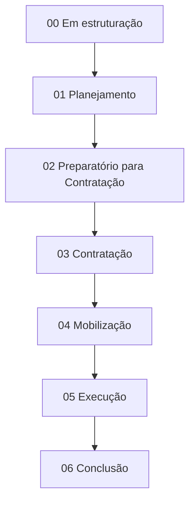
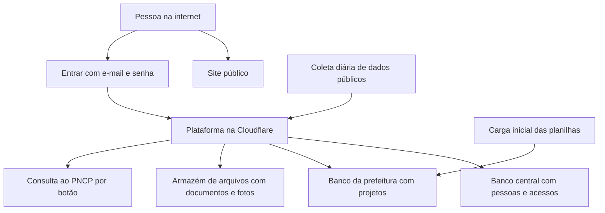

# 1. Visão geral do sistema

**Para que serve este capítulo.** Explica, em linguagem simples, o que é o GovNexa, para quem ele foi feito, como o menu se organiza, que caminho um projeto percorre da ideia à entrega e como o sistema funciona por dentro. É a porta de entrada do manual: leia antes dos outros capítulos.

## 1.1 O que é o GovNexa

O GovNexa é a plataforma de gestão da carteira de projetos e obras da prefeitura. Ele nasceu para **substituir a planilha de obras prioritárias**: cada projeto é cadastrado uma vez e acompanhado do começo ao fim, da ideia até a obra entregue à população (`README.md`, seção 1).

O piloto é a Prefeitura de Goiânia. O endereço de produção é https://govnexa.com.br (`wrangler.jsonc`, campo `routes`).

O sistema responde, sem montar planilha à mão, às perguntas que a gestão faz toda semana (`README.md`, seção 1.1):

- em que etapa está cada projeto e quanto ele vale;
- onde o trabalho está parado, com quem e há quantos dias;
- quais prazos estão vencendo (obras, contratações, convênios);
- quanto do orçamento ainda não tem fonte de recurso.

### Para quem é

| Público | O que usa mais |
|---|---|
| Prefeito e gabinete | Visão gerencial: prioritários, mapa e painel |
| Secretários e chefias | Carteira, Kanban, Gantt, alertas |
| Equipe técnica de projetos | Ficha do projeto, cronogramas, responsáveis |
| Equipe de licitações | Gestão das licitações e PNCP |
| Equipe de captação | Convênios, CAUC, oportunidades |
| Administrador do sistema | Usuários e perfis |

Origem: `src/lib/govnexa/catalogo.ts` (`MODULOS`, descrição de cada visão).

## 1.2 As três visões e o menu

O menu lateral tem **cinco áreas**. As três primeiras são as "visões" do produto, decididas pelo dono em 22/11/2026; depois vêm Licitações e Conta (`src/lib/govnexa/catalogo.ts`, `MODULOS` e `ITENS_DA_VISAO`; `README.md`, seção 1.1, princípio "Três visões").

| Área do menu | Pergunta que responde | Exemplos de telas |
|---|---|---|
| Visão gerencial | O que o prefeito precisa ver para decidir? | Projetos prioritários, Carteira, Mapa e painel, Gestão das licitações, Kanban, Gantt |
| Governança da execução | Como está o trabalho da equipe? | Cronogramas, Responsáveis, Onde está parado, Pendências de etapa, Histórico, Alertas |
| Convênios | Como estão a captação e os repasses? | Visão Convênios, Acompanhamento, Oportunidades, Qualidade dos dados |
| Licitações | Área de demonstração | Licitação em detalhe, Prazos da Lei 14.133 e telas de protótipo |
| Conta | Ajustes do sistema | Usuários, Fluxo do sistema, WhatsApp, Relatórios, Perfil, Configurações |

Regras do menu:

- Toda tela fica em exatamente um lugar do menu (`src/lib/govnexa/catalogo.ts`, `moduloDoItem`).
- Cada pessoa só vê no menu as telas que o seu perfil pode abrir. Hoje três telas têm regra própria: Usuários (só administrador), Painel da equipe e Inconsistências (administrador, gestor e editor). A própria página confere de novo e recusa quem não pode (`src/lib/govnexa/catalogo.ts`, `PERMISSAO_DO_ITEM`).
- Duas telas existem fora do menu e abrem por botão: "Novo projeto" e "Obras sem localização" (`src/lib/govnexa/catalogo.ts`, `FORA_DO_MENU`).
- Atenção: a **Gestão das licitações**, que funciona de verdade, fica na Visão gerencial, e não na área Licitações. A área Licitações reúne telas de demonstração.

O mapa completo do menu, tela por tela, está no capítulo 2 (seção 2.11).

## 1.3 O ciclo de um projeto, da ideia à entrega

Todo projeto passa por **sete macroetapas**, numeradas de 00 a 06. A macroetapa é a fase do ciclo em que o projeto está (`src/lib/carteira/macroetapas.ts`, `MACROETAPAS`).

Em palavras simples:

1. **Ideia ou demanda (00).** O projeto é cadastrado na tela "Novo projeto", só com nome e órgão. Ele nasce em "00 – Em estruturação" (`src/lib/carteira/movimentacao.ts`, `criarProjeto`).
2. **Planejamento e peças técnicas (01 e 02).** A equipe completa valores, origem do recurso, datas previstas, localização, fotos e documentos (DFD, ETP, TR). O cronograma do projeto pode ser criado na tela.
3. **Recurso.** Em paralelo, a equipe de captação acompanha convênios, programas abertos e a regularidade no CAUC (área Convênios).
4. **Contratação (03).** A licitação ou outra forma de contratação é acompanhada na Gestão das licitações, com seis etapas próprias e marcos, e pode ser ligada à compra publicada no PNCP.
5. **Mobilização e execução (04 e 05).** O cronograma mostra tarefas, responsáveis, tempo na mão e atrasos.
6. **Entrega (06).** O projeto vai para "06 – Conclusão" e sai do quadro Kanban.

Para passar de uma macroetapa à seguinte, o projeto precisa cumprir um **portão**: uma lista mínima de dados exigidos (por exemplo, para chegar a 02 é preciso valor da obra, origem do valor e data das peças técnicas). Se faltar algo, a pessoa pode "forçar com motivo", e o Histórico registra a exceção. Voltar uma etapa ou pular etapas também exige motivo (`src/lib/carteira/movimentacao.ts`, `portaoPara`; `src/lib/carteira/mover.ts`). O detalhe de cada portão está no capítulo de processos de negócio.

Toda mudança fica no **Histórico de alterações**, que não pode ser alterado nem apagado (`db/d1/prefeitura/0001_carteira.sql`, gatilhos de histórico imutável).

## 1.4 Como o sistema se organiza

O GovNexa tem duas partes visíveis e algumas partes de bastidor (`docs/manual/_rascunho/09-fluxo-importacoes-plataforma.md`, seção "Visão da arquitetura"; `wrangler.jsonc`).

- **Site público.** Páginas abertas a qualquer pessoa (início, Sobre, Setor público, Insights, Demonstração, Termos, Privacidade). Não mostram dado interno (`src/pages/index.astro`, `src/pages/sobre.astro`, `src/pages/insights/`).
- **Plataforma.** Tudo o que fica em `/plataforma/`. Só abre para quem tem cadastro ativo e entrou com login. Um programa que roda na Cloudflare (chamado *Worker*) confere o login, descobre a prefeitura da pessoa e entrega só os dados dela (`worker/index.ts`, `src/middleware.ts`).
- **Banco central.** Guarda quem pode entrar, o perfil de cada pessoa, as sessões abertas e qual prefeitura cada uma acessa (`db/d1/central/`).
- **Banco da prefeitura.** Um banco para cada prefeitura, com projetos, cronogramas, contratações, PNCP e históricos. Ninguém escolhe outra prefeitura pela tela: o banco vem do cadastro da pessoa (`src/lib/usuarios/index.ts`, `prefeituraDoUsuario`; `src/lib/repositorio/index.ts`).
- **Armazém de arquivos.** Onde ficam os documentos e as fotos das obras. O banco guarda só a referência de cada arquivo (`wrangler.jsonc`, `govnexa-documentos`).
- **Coleta de dados públicos.** Rotinas automáticas no GitHub buscam todo dia dados do Transferegov, CAUC, SICONFI, FNS, IBGE e programas abertos, e uma vez por mês INEP, SINISA e CNES. Os dados novos só entram no site depois que o dono aprova a atualização (`.github/workflows/atualizar-dados.yml`, `.github/workflows/atualizar-dados-mensais.yml`). Esses dados alimentam a área Convênios, não o banco da prefeitura.
- **Carga inicial das planilhas.** Um comando da equipe técnica trouxe a carteira e os cronogramas das planilhas antigas para o banco. Não é uma tela (`scripts/importar-planilhas.ts`).
- **E-mail.** Usado só para convites e redefinição de senha, de um remetente único de não-resposta (`wrangler.jsonc`, `send_email`).
- **Limite de uso.** Cada pessoa pode fazer até 30 gravações por minuto; acima disso o sistema pede para esperar (`wrangler.jsonc`, `ratelimits`; `src/lib/seguranca/limite.ts`).

## 1.5 Princípios do produto

Estes princípios valem para todas as telas (`README.md`, seção 1.1, tabela "Princípios").

### O sistema substitui a planilha

A planilha serviu só para a carga inicial. A partir daí, todo processo tem início, meio e fim na tela: criar, editar, avançar, concluir, sempre com registro no Histórico. **Depois da carga, a tela vence a planilha**: se a planilha for carregada de novo, ela não sobrescreve o que a equipe mudou no sistema (`scripts/importar-planilhas.ts`, `avaliarImportacao`; `db/d1/prefeitura/0009_cronograma_na_tela.sql`, marca `editado_na_tela`).

### Sempre poder voltar

Toda tela aberta a partir de outra mostra, no alto, o link "← Voltar para [tela de origem]", com os mesmos filtros que a pessoa usava. Ninguém se perde ao navegar entre listas, fichas e painéis (`src/lib/navegacao/volta.ts`, `src/components/navegacao/Voltar.astro`).

### Calcular, não digitar

A situação de uma tarefa, os atrasos, os alertas e os totais são **calculados** a partir das datas e valores. A equipe só registra fatos: iniciou, concluiu, enviou, voltou (`README.md`, seção 1.1). Dado que falta não vira zero: aparece "—" e entra como pendência de dado.

### Tudo deixa rastro

Cada gravação registra quem fez, quando, de onde veio, o valor antes e depois e o motivo. Remover um item é sempre "remoção lógica": ele some das listas, mas continua guardado para auditoria (`db/d1/prefeitura/0001_carteira.sql`, `0008_foto_projeto.sql`, `0010_contratacao.sql`).

### O que é real e o que é demonstrativo

Parte do sistema grava no banco de verdade; outra parte é **simulação**, para mostrar como vai funcionar. A faixa no alto de toda tela da plataforma avisa: "Dados de exemplo nos módulos demonstrativos, salas, reuniões, WhatsApp e mapa por bairro" (`src/layouts/Platform.astro`).

| Funciona de verdade (grava no banco) | Demonstrativo (nada é gravado no servidor) |
|---|---|
| Carteira, ficha, Novo projeto, Kanban, Gantt | Reunião semanal |
| Localização, fotos e documentos | Sala de guerra |
| Cronogramas, responsáveis, onde está parado | WhatsApp |
| Pendências de etapa e Histórico | Processos no SEI |
| Gestão das licitações e PNCP por botão | Licitação em detalhe |
| Usuários, login e verificação em duas etapas | Projetos (parecer) da área Convênios |
| Alertas e área Convênios (só leitura de dados públicos) | Telas de protótipo das áreas Licitações e Conta |

Origem: `src/pages/plataforma/[...module].astro` (textos de apresentação de cada tela), `src/lib/reuniao/simulacao.ts`, `src/lib/sala/simulacao.ts`, `src/lib/whatsapp/simulacao.ts`, `src/lib/sei/simulacao.ts`, `src/lib/licitacao/simulacao.ts`, `src/lib/projetos/guia.ts`.

## 1.6 Como entrar e quais são os perfis

### Como entrar

1. Abra https://govnexa.com.br/entrar/.
2. Digite o e-mail e a senha e passe pela verificação "não sou robô".
3. Digite os 6 dígitos que aparecem no aplicativo autenticador do celular (a **2ª etapa**). Se perdeu o celular, use um dos códigos de recuperação.
4. Pronto: a plataforma abre na tela "Projetos prioritários".

Primeiro acesso: o administrador cadastra a pessoa e o sistema envia um e-mail "Defina sua senha", com link válido por 24 horas. A pessoa cria a senha, configura o aplicativo lendo um QR Code e guarda 10 códigos de recuperação, mostrados uma única vez. Esqueceu a senha: use "Esqueci minha senha" na tela de entrada; o link vale 1 hora (`src/pages/entrar/`, `src/lib/login/servico.ts`, `src/lib/login/tokens.ts`).

A sessão dura até 12 horas e cai depois de 2 horas sem uso (`src/lib/login/sessao.ts`). O modo de login em produção é "senha" (`wrangler.jsonc`, `LOGIN_MODO`).

### Perfis em uma linha

| Perfil | O que pode fazer |
|---|---|
| Administrador | Tudo, inclusive cadastrar pessoas, secretarias compradoras e dispensar a 2ª etapa de outra pessoa |
| Gestor | Ver, editar projetos, enviar documentos e aprovar mudança de etapa |
| Editor | Ver, editar projetos e enviar documentos |
| Leitura | Só consultar (é a "conta de consulta") |

Origem: `src/lib/usuarios/index.ts` (`permissoes`). A matriz completa de perfis está no capítulo 2 (seção 2.8).

## 1.7 Situação do produto em 24/11/2026

- **No ar:** entregas E1 a E13 e E15 a E18, e a E14a (PNCP por botão). Inclui carteira, ficha, Kanban, Gantt, mapa, fotos, documentos, busca por endereço, cronogramas editáveis, responsáveis, Gestão das licitações, menu em três visões, voltar à tela de origem, Fluxo em PDF por partes, ícone de tema claro e escuro, dispensa temporária da 2ª etapa e conta de consulta (`README.md`, seção 2).
- **Previsto, ainda não no ar:** retirada do farol de cores (E19); envolvidos e recursos por tarefa (E20); sugestões, atualização automática diária e varredura do PNCP (E14b a E14e). Este manual descreve o sistema como ele está hoje.

## 1.8 Legenda das marcas deste manual

| Marca | Significado |
|---|---|
| **[DEMONSTRATIVO]** | A tela funciona como simulação: usa dados de exemplo ou guarda só no navegador. Nada vai para o banco. |
| **[INCOMPLETO]** | A funcionalidade está prevista e aparece no plano ou na tela, mas ainda não está ligada. |
| **[VERIFICAR]** | Ponto que o código não deixa claro ou que diverge de outro documento. Precisa de confirmação do dono ou da equipe técnica. |

Exemplo de uso: o "farol" (cores vermelho, amarelo e verde por projeto) ainda aparece na tela "Projetos · Início", em Mapa e painel, no Painel da equipe, na Reunião semanal e na Sala de guerra **[VERIFICAR]**: será retirado (decisão do dono, E19) (`src/lib/carteira/visoes.ts`, `farol`; `src/lib/carteira/modulos.ts`).

## Onde aprofundar

- **Capítulo 2 — Módulos e funcionalidades:** inventário de todas as telas, quem grava em cada uma e o mapa completo do menu.
- **Capítulos de processos de negócio, dados e dependências:** o passo a passo de cada processo, as tabelas do banco e como os módulos conversam.
- **Capítulo 6 — Glossário:** significado de macroetapa, portão, CAUC, PNCP, SEI, tempo na mão e outros termos.
