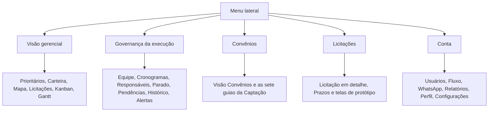

# 2. Módulos e funcionalidades

**Para que serve este capítulo.** Lista todas as telas e funcionalidades do GovNexa, módulo por módulo, dizendo o que cada uma faz, quem pode gravar nela e em que arquivo do código ela está. No fim, mostra o mapa do menu (em qual das cinco áreas fica cada tela) e o estado de cada módulo: no ar, demonstrativo ou incompleto.

Como ler as tabelas:

- **Quem grava** usa os perfis do sistema: Administrador, Gestor, Editor e Leitura. "Edição" quer dizer Administrador, Gestor e Editor (a permissão `editar_projeto`). "Ninguém" quer dizer que a tela só mostra dados.
- Todas as telas da plataforma exigem login e cadastro ativo. Salvo indicação, qualquer perfil consulta (`src/lib/usuarios/index.ts`, `permissoes`; `worker/index.ts`).
- **Origem** é o arquivo principal, com caminho a partir da raiz do repositório.

## 2.1 Carteira de projetos

O cadastro central de todos os projetos da prefeitura. Cada projeto tem uma ficha única, uma macroetapa (00 a 06) e um histórico.

| Tela ou funcionalidade | O que faz | Quem grava | Origem |
|---|---|---|---|
| Projetos · Início | Resumo por macroetapa: quantidade, valor e contagem por cor do farol | Ninguém | `src/lib/carteira/modulos.ts` |
| Novo projeto | Cadastra projeto; só nome e órgão são obrigatórios | Edição | `src/components/carteira/NovoProjeto.astro` |
| Código automático | Projeto criado na tela recebe código a partir de P-9000 | Automático | `src/lib/carteira/movimentacao.ts` |
| Carteira de projetos | Lista agrupada por macroetapa, ordenada pela entrega | Ninguém | `src/components/carteira/CarteiraProjetos.astro` |
| Filtros | Nome ou código, órgão, área, macroetapa, período, só prioritários | Ninguém | `src/lib/carteira/filtros.ts` |
| Grandes números | Quantidade e valor total; avisa projetos sem valor | Ninguém | `src/lib/carteira/lista.ts` |
| Imprimir ou salvar em PDF | Impressão com data, hora e filtros no cabeçalho | Ninguém | `src/components/carteira/CarteiraProjetos.astro` |
| Ficha do projeto | Página única com 11 abas | Conforme a aba | `src/pages/plataforma/projeto/[id].astro` |
| Ficha · Cadastro | Edita campos com motivo; grava só o que mudou | Edição | `src/lib/carteira/edicao.ts` |
| Ficha · Área e Prioritário | Área do catálogo da prefeitura e marca de prioritário | Edição | `src/lib/carteira/area.ts` |
| Ficha · Observação | Texto livre de até 2.000 caracteres em destaque | Edição | `src/lib/carteira/cadastro.ts` |
| Ficha · Recurso e Entrega | Origem do recurso, valores e datas previstas | Edição, pela aba Cadastro | `src/lib/carteira/ficha-dados.ts` |
| Ficha · Histórico | Últimos 50 registros do projeto | Automático | `src/pages/plataforma/projeto/[id].astro` |
| Ficha · Governança | Origem do dado, pendências, SEI e dependências | Ninguém | `src/lib/carteira/ficha-dados.ts` |
| Kanban por macroetapa | Colunas 00 a 05; mover por botão ou arrastar | Edição | `src/components/carteira/Kanban.astro` |
| Gantt geral | Linha do tempo por macroetapa, de 2026 a 2029 | Ninguém | `src/components/carteira/Gantt.astro` |
| Endereço antigo Visão por órgão | Redireciona para a Carteira filtrada pelo órgão | Ninguém | `src/lib/carteira/lista.ts` |

Observações:

- Mudança de valor ou de prioridade exige motivo. Se outra pessoa alterou o projeto ao mesmo tempo, a gravação é recusada e a tela pede para recarregar (`src/lib/carteira/edicao.ts`).
- A coluna "06 – Conclusão" não aparece no Kanban; os concluídos ficam na Carteira e no Histórico (`src/lib/carteira/kanban.ts`).
- O farol (verde, amarelo e vermelho) de "Projetos · Início" é calculado pelo prazo da macroetapa e pelas pendências de dado **[VERIFICAR]**: será retirado (decisão do dono, E19) (`src/lib/carteira/visoes.ts`, `farol`).
- Valores executado, captado e contrapartida não são editáveis pela tela, mas o portão para 06 exige o valor executado **[VERIFICAR]** como ele é informado hoje (`src/lib/carteira/edicao.ts`, `src/lib/carteira/movimentacao.ts`).

## 2.2 Localização, mapa, fotos e documentos

Onde a obra fica, o mapa da cidade, as fotos e os documentos de cada projeto.

| Tela ou funcionalidade | O que faz | Quem grava | Origem |
|---|---|---|---|
| Ficha · Localização | Um ponto ou ruas e trechos no mapa | Edição | `src/components/carteira/ficha/LocalizacaoFicha.astro` |
| Procurar no mapa | Busca endereço, rua ou bairro no OpenStreetMap; até 5 resultados | Edição | `src/components/mapa/EditorLocalizacao.astro` |
| Obras sem localização | Lista obras fora do mapa, por bairro; leva à ficha | Ninguém | `src/pages/plataforma/projetos-localizacao/index.astro` |
| Mapa das obras | Bolhas por região e bairro, cor por área, ficha resumida | Ninguém | `src/components/mapa/MapaObras.astro` |
| Filtros do mapa | Macroetapa, área e região; estado guardado no endereço | Ninguém | `src/components/mapa/MapaObras.astro` |
| Camadas do mapa | Mapa, satélite ou híbrido | Ninguém | `src/lib/mapa/camadas.ts` |
| Apresentar mapa | Tela cheia para reuniões | Ninguém | `src/components/mapa/MapaObras.astro` |
| Mapa compacto | Miniatura na tela inicial com "Ampliar mapa" | Ninguém | `src/components/gestao/ProjetosPrioritarios.astro` |
| Ficha · Fotos | JPG, PNG ou WEBP até 10 MB, com legenda e data | Edição | `src/components/carteira/ficha/FotosFicha.astro` |
| Documentos do projeto | Envia, classifica por tipo, baixa e remove | Edição | `src/pages/plataforma/documentos-projeto/projeto/[id].astro` |
| Documentos · escolha do projeto | Lista suspensa para abrir os documentos de um projeto | Ninguém | `src/pages/plataforma/documentos-projeto/index.astro` |
| Ficha · Documentos | Resumo por tipo e os 5 mais recentes | Ninguém | `src/pages/plataforma/projeto/[id].astro` |

Observações:

- O ponto precisa estar dentro de Goiânia e entorno; até 20 trechos por obra (`src/lib/mapa/geo.ts`).
- Obra sem localização própria aparece no centro do bairro, com contorno tracejado ("local aproximado") (`src/lib/mapa/geo.ts`).
- Documentos aceitos: PDF, imagens e arquivos de Office, até 25 MB. Tipos DFD, ETP e TR são fixos; outros (Mapa de riscos, Projeto básico, ART etc.) nascem desativados (`src/lib/documentos/regras.ts`, `db/d1/prefeitura/0003_tipo_documento.sql`). **[VERIFICAR]** não há tela para ativar esses tipos.
- O mesmo arquivo não pode ser enviado duas vezes no mesmo projeto (fotos e documentos).
- Envio e remoção de foto vão ao Histórico; de documento, só a troca de tipo vai ao Histórico **[VERIFICAR]** (`src/lib/fotos/repositorio.ts`, `src/lib/documentos/repositorio.ts`).

## 2.3 Cronogramas e governança da execução

O cronograma de cada projeto, com tarefas, responsáveis, tempo na mão e atrasos.

| Tela ou funcionalidade | O que faz | Quem grava | Origem |
|---|---|---|---|
| Cronogramas | Lista com fase atual, % realizado e previsto, ritmo e atrasos | Ninguém | `src/lib/cronograma/modulos.ts` |
| Novo cronograma | Cria cronograma vazio para projeto que ainda não tem | Edição | `src/pages/plataforma/cronograma/novo.astro` |
| Página do cronograma | Resumo e cinco abas | Conforme a aba | `src/pages/plataforma/cronograma/[id].astro` |
| Aba Linha do tempo | Barras de previsto contra real, por mês | Ninguém | `src/components/cronograma/LinhaDoTempo.astro` |
| Aba Quadro de tarefas | Colunas por situação, com selo Atenção ou Urgente | Ninguém | `src/components/cronograma/QuadroTarefas.astro` |
| Aba Dependências | De quem cada etapa depende e o atraso em cascata | Ninguém | `src/lib/cronograma/dependencias.ts` |
| Aba Pendências de dado | Problemas de dado do cronograma e das tarefas | Ninguém | `src/pages/plataforma/cronograma/[id].astro` |
| Aba Tarefas e responsáveis | Incluir, editar, iniciar, concluir, reordenar, remover | Edição | `src/components/cronograma/TarefasResponsaveis.astro` |
| Trocar responsável | Novo responsável ou área a partir de uma data, com histórico | Edição | `src/lib/cronograma/planejar.ts` |
| Responsáveis | Tarefas abertas por pessoa e por área, com dias na mão | Ninguém | `src/pages/plataforma/gestao-responsaveis/index.astro` |
| Responsáveis · CSV e impressão | Exporta a lista filtrada | Ninguém | `src/pages/plataforma/gestao-responsaveis/csv.ts` |
| Onde está parado | Etapas vencidas por unidade e por responsável | Ninguém | `src/components/cronograma/Parado.astro` |
| Pendências de etapa | Aprovar, reprovar ou aprovar mesmo assim a mudança de macroetapa | Administrador e Gestor | `src/components/carteira/PendenciasEtapa.astro` |

Observações:

- Um projeto tem no máximo um cronograma, com até 500 tarefas (`src/lib/cronograma/planejar.ts`).
- A situação da tarefa é calculada pelas datas: A fazer, Início atrasado, Em andamento, Atrasada ou Concluída (`src/lib/cronograma/visoes.ts`).
- Alerta de tempo na mão: Atenção quando passa da duração prevista; Urgente quando passa do dobro (`src/lib/cronograma/responsaveis.ts`).
- O ritmo do cronograma usa cores (verde a partir de 0,95; amarelo de 0,85 a 0,95; vermelho abaixo) (`src/lib/cronograma/visoes.ts`, `farolRitmo`) **[VERIFICAR]** se também sai com a retirada do farol (E19).
- Cronograma alterado na tela fica protegido: a planilha não o altera mais (`db/d1/prefeitura/0009_cronograma_na_tela.sql`).
- Envolvidos e recursos por tarefa (E20) ainda não estão no ar **[INCOMPLETO]**.

## 2.4 Visão gerencial e acompanhamento

As telas que mostram à gestão como está a carteira.

| Tela ou funcionalidade | O que faz | Quem grava | Origem |
|---|---|---|---|
| Projetos prioritários | Tela inicial do prefeito: etapas, áreas, linha do tempo, entregas, mapa | Ninguém | `src/components/gestao/ProjetosPrioritarios.astro` |
| Filtros da tela inicial | Só prioritários, etapa, área, órgão, região e período | Ninguém | `src/lib/gestao/prioritarios.ts` |
| Principais obras e próximas entregas | Até 5 obras principais e 8 próximas entregas | Ninguém | `src/lib/gestao/prioritarios.ts` |
| Mapa e painel | Seis cartões, mapa, fases, contratação, execução, parado, atenção, convênios | Ninguém | `src/components/gestao/PainelPrefeito.astro` |
| Painel da equipe | Dez cartões com detalhe e "Como é calculado" | Ninguém; só Edição abre | `src/pages/plataforma/gestao-equipe/index.astro` |
| Inconsistências de dados | Dez regras de dado faltando ou errado, com CSV | Ninguém; só Edição abre | `src/lib/gestao/inconsistencias.ts` |
| Reunião semanal | Pauta automática, decisões, ações e ata em PDF | Ninguém, simulação **[DEMONSTRATIVO]** | `src/components/reuniao/ReuniaoSemanal.astro` |
| Sala de guerra | Salas de crise ou missão, riscos, ações, problemas e decisões | Ninguém, simulação **[DEMONSTRATIVO]** | `src/components/sala/SalaGuerra.astro` |
| Agenda de prazos | Arquivo de calendário com prazos de convênios | Ninguém | `src/pages/plataforma/agenda.ics.ts` |

Observações:

- A tela inicial não mostra farol nem prazo vencido; mostra etapa, área e entrega (`src/lib/gestao/prioritarios.ts`).
- Mapa e painel, Painel da equipe, Reunião semanal e Sala de guerra ainda usam o farol para "projetos em atenção" e "atrasados" **[VERIFICAR]**: será retirado (decisão do dono, E19) (`src/lib/carteira/visoes.ts`).
- Reunião semanal e Sala de guerra guardam o que a pessoa faz só no navegador; as salas vêm de dados de exemplo (`src/lib/sala/carga.ts`, `src/lib/reuniao/simulacao.ts`).
- Painel da equipe e Inconsistências ficam escondidos do menu para o perfil Leitura, e a página recusa o acesso (`src/lib/gestao/equipe.ts`, `podeVerEquipe`).

## 2.5 Alertas, WhatsApp, Histórico e navegação

Recursos de apoio usados em todo o sistema.

| Tela ou funcionalidade | O que faz | Quem grava | Origem |
|---|---|---|---|
| Central de alertas | Todos os alertas do dia, vermelho primeiro, com "O que fazer" | Ninguém | `src/components/alertas/CentralAlertas.astro` |
| Alertas · filtros e cartões | Por tipo, gravidade e órgão | Ninguém | `src/components/alertas/CentralAlertas.astro` |
| Alertas · Ainda sem fonte de dados | Mostra alertas previstos que ainda não têm dado | Ninguém | `src/lib/alertas/central.ts` |
| WhatsApp | Números autorizados, permissões, prévia da conversa e modelos | Ninguém, simulação **[DEMONSTRATIVO]** | `src/components/whatsapp/WhatsAppGestao.astro` |
| Histórico de alterações | Tudo o que mudou, 25 por página, com detalhes antes e depois | Automático | `src/components/log/LogAlteracoes.astro` |
| Histórico · filtros | Período, projeto, pessoa, ação, origem, só exceções, busca | Ninguém | `src/lib/log/visoes.ts` |
| Histórico · CSV | Exporta o resultado filtrado | Ninguém | `src/lib/log/visoes.ts` |
| Voltar | "← Voltar para [tela]" com os filtros da origem | Não se aplica | `src/lib/navegacao/volta.ts` |

Observações:

- Tipos de alerta: cláusula suspensiva, vigência de convênio, homologação e contrato, início de obra, fim de obra, saldo sem fonte, etapa parada, dado defasado e prazo da Lei 14.133 (`src/lib/alertas/central.ts`).
- Os alertas são calculados a cada abertura da tela. Não há como marcar um alerta como resolvido; ele some quando o dado muda.
- Alertas de prazo da Lei 14.133 e de "edital na praça" ainda não têm dado de entrada **[INCOMPLETO]** (`src/components/alertas/CentralAlertas.astro`, `eventosLei: []`).
- O WhatsApp não envia nenhuma mensagem; a conta oficial da Meta e o registro de mensagens são planos **[INCOMPLETO]** (`src/lib/whatsapp/simulacao.ts`).
- O Histórico não pode ser alterado nem apagado; cada prefeitura vê só o seu (`db/d1/prefeitura/0001_carteira.sql`).

## 2.6 Licitações, PNCP e processos no SEI

As contratações da prefeitura, a ligação com o Portal Nacional de Contratações Públicas e a leitura dos processos no SEI.

| Tela ou funcionalidade | O que faz | Quem grava | Origem |
|---|---|---|---|
| Gestão das licitações | Contratações em seis etapas, números, marcos e filtros | Edição | `src/pages/plataforma/gestao-licitacoes/index.astro` |
| Nova contratação | Cadastro; pode vir já ligado a um projeto da ficha | Edição | `src/lib/contratacoes/servico.ts` |
| Edição em linha | Altera um campo direto na tabela | Edição | `src/lib/contratacoes/servico.ts` |
| Página da contratação | Campos, economia, % pago, etapa, marcos e Histórico | Edição | `src/pages/plataforma/gestao-licitacoes/[id].astro` |
| Mudar etapa | Avança; pular ou voltar exige motivo | Edição | `src/lib/contratacoes/regras.ts` |
| Marcos | Homologada, contrato assinado, ordem de serviço, em execução | Edição | `src/lib/contratacoes/regras.ts` |
| Remover contratação | Remoção lógica com motivo | Edição | `db/d1/prefeitura/0010_contratacao.sql` |
| Licitações · CSV e impressão | Exporta e imprime com os filtros | Ninguém | `src/pages/plataforma/gestao-licitacoes/csv.ts` |
| Ficha · Contratações | Contratações do projeto e atalho para cadastrar | Edição | `src/pages/plataforma/projeto/[id].astro` |
| Secretarias compradoras | Cadastro por CNPJ dos órgãos que publicam no PNCP | Só Administrador | `src/pages/plataforma/gestao-licitacoes/secretarias/index.astro` |
| Ligar ao PNCP | Cola número ou link, vê a prévia e confirma | Edição | `src/lib/pncp/servico.ts` |
| Dados do PNCP | Situação, itens, vencedores, valores e classificação de obra | Ninguém | `src/components/licitacao/DadosPncp.astro` |
| Atualizar agora | Busca de novo no PNCP, com trava de 10 minutos | Edição | `src/lib/pncp/servico.ts` |
| Desligar do PNCP | Desfaz a ligação com motivo | Edição | `src/lib/pncp/servico.ts` |
| Ficha · Processos SEI | Mostra os números do SEI do projeto | Ninguém | `src/pages/plataforma/projeto/[id].astro` |
| Processos no SEI | Explica e simula a leitura do SEI **[DEMONSTRATIVO]** | Ninguém | `src/components/sei/ProcessosSei.astro` |
| Licitação em detalhe | Lê a página do SEI salva e monta 12 fases **[DEMONSTRATIVO]** | Ninguém | `src/components/licitacao/LicitacaoDetalhe.astro` |
| Prazos da Lei 14.133 | Tabela de prazos, metas e calculadora de dias úteis **[DEMONSTRATIVO]** | Ninguém | `src/components/prazos/PrazosLei.astro` |

Observações:

- Etapas da contratação: Projeto em finalização, Em preparação, Edital em ajustes, Publicada, Em julgamento, Concluída (`src/lib/contratacoes/regras.ts`, `ETAPAS`).
- O PNCP só mostra os dados; não altera os campos da contratação. A atualização é só por botão. Sugestões e atualização automática diária (E14b a E14e) **[INCOMPLETO]** (`docs/govnexa/plano-e14-pncp.md`).
- A leitura diária do SEI no servidor não existe; Processos no SEI e Licitação em detalhe guardam tudo só no navegador **[INCOMPLETO]** (`src/lib/sei/simulacao.ts`, `src/lib/licitacao/simulacao.ts`).
- Os prazos da Lei 14.133 têm a nota "Conferir no texto oficial antes de usar em produção" **[VERIFICAR]** revisão jurídica (`src/lib/prazos/lei14133.ts`).

## 2.7 Convênios e captação de recursos

Convênios em execução e em risco, regularidade no CAUC, programas abertos e qualidade dos dados públicos. Este módulo **só lê e mostra**; nada é gravado nele.

| Tela ou funcionalidade | O que faz | Quem grava | Origem |
|---|---|---|---|
| Visão Convênios | Em execução, em risco e regularidade no CAUC | Ninguém | `src/pages/plataforma/convenios/index.astro` |
| Principal | Indicadores do município com fonte e data | Ninguém | `src/lib/dados/principal.ts` |
| Acompanhamento | Convênios em execução por saldo a liberar, com detalhe | Ninguém | `src/lib/dados/captacao.ts` |
| Alertas da captação | Vigência, desembolso, CAUC, programas, DOU e fontes | Ninguém | `src/lib/dados/alertas.ts` |
| Oportunidades | Programas abertos do Transferegov, com prazo e tema | Ninguém | `src/lib/dados/captacao.ts` |
| Projetos | Parecer de elegibilidade com 2 projetos fictícios **[DEMONSTRATIVO]** | Ninguém | `src/lib/projetos/guia.ts` |
| Comparativo | Repasses de saúde por habitante entre capitais | Ninguém | `src/lib/dados/comparativo.ts` |
| Qualidade dos dados | Idade de cada fonte, situação, motivo e ação | Ninguém | `src/lib/dados/qualidade.ts` |
| Coleta diária e mensal | Rotinas do GitHub que buscam os dados públicos | Rotina automática | `.github/workflows/atualizar-dados.yml` |

Observações:

- Os dados vêm de fontes públicas federais e ficam em arquivos, não no banco da prefeitura (`src/lib/dados/arquivos.ts`).
- Os dados novos só aparecem depois que o dono aprova a atualização automática no GitHub (`.github/workflows/atualizar-dados.yml`).
- As telas da captação mostram um botão "Novo registro" que só avisa "protótipo: nada é gravado" **[VERIFICAR]** se deve ser escondido (`src/pages/plataforma/[...module].astro`).
- Há duas famílias de regras de alerta de convênio, com prazos diferentes, na Visão Convênios e na guia Alertas **[VERIFICAR]** (`src/lib/alertas/central.ts`, `src/lib/dados/alertas.ts`).
- O Portal da Transparência é coletado só à mão e nenhuma tela lê o resultado **[INCOMPLETO]** (`coletores/portal-transparencia.ts`).

## 2.8 Usuários, login, perfis e segurança

Quem entra, com qual perfil e o que cada pessoa pode fazer.

| Tela ou funcionalidade | O que faz | Quem grava | Origem |
|---|---|---|---|
| Entrar | E-mail, senha e verificação "não sou robô" | A própria pessoa | `src/pages/entrar/index.astro` |
| Código da 2ª etapa | 6 dígitos do aplicativo ou código de recuperação | A própria pessoa | `src/pages/entrar/codigo.astro` |
| Configurar o aplicativo | QR Code e 10 códigos de recuperação, no primeiro acesso | A própria pessoa | `src/pages/entrar/configurar.astro` |
| Definir senha | A partir do link do convite ou da redefinição | A própria pessoa | `src/pages/entrar/definir-senha.astro` |
| Esqueci a senha | Envia link de 1 hora; resposta sempre igual | A própria pessoa | `src/pages/entrar/esqueci.astro` |
| Usuários | Lista as pessoas da prefeitura e sua situação | Só Administrador | `src/pages/plataforma/usuarios/index.astro` |
| Cadastrar e convidar | Cria a pessoa e envia o convite por e-mail | Só Administrador | `src/pages/plataforma/usuarios/acao.ts` |
| Alterar perfil, desativar, reativar | Ajusta o acesso de uma pessoa | Só Administrador | `src/lib/login/servico.ts` |
| Desbloquear e redefinir 2ª etapa | Libera conta bloqueada ou zera o aplicativo | Só Administrador | `src/lib/login/servico.ts` |
| Dispensar a 2ª etapa | Entrada só com senha por 1 a 60 dias, com motivo | Administrador, só para outra pessoa | `db/d1/central/0003_excecao_2fa.sql` |

Matriz de perfis (`src/lib/usuarios/index.ts`, `permissoes`):

| Ação | Administrador | Gestor | Editor | Leitura |
|---|:-:|:-:|:-:|:-:|
| Ver as telas | Sim | Sim | Sim | Sim |
| Editar projetos, cronogramas, contratações, fotos | Sim | Sim | Sim | Não |
| Aprovar mudança de etapa | Sim | Sim | Não | Não |
| Enviar documentos | Sim | Sim | Sim | Não |
| Gerenciar usuários | Sim | Não | Não | Não |
| Cadastrar secretarias compradoras | Sim | Não | Não | Não |
| Dispensar a 2ª etapa | Sim | Não | Não | Não |
| Importar dados | Sim | Não | Não | Não |

Observações:

- A ação "importar dados" existe, mas nenhuma tela a usa; a carga é um comando da equipe técnica **[INCOMPLETO]** (`src/lib/usuarios/index.ts`, `scripts/importar-planilhas.ts`).
- Não se pode desativar nem rebaixar o último administrador ativo (`src/lib/login/servico.ts`).
- Proteções: limite de tentativas de login, bloqueio temporário, sessões de 12 horas, cabeçalhos de segurança e limite de 30 gravações por minuto por pessoa (`src/lib/login/limites.ts`, `worker/index.ts`, `src/lib/seguranca/limite.ts`).
- Não há tela para a própria pessoa trocar a senha estando logada; só o "Esqueci a senha" **[VERIFICAR]**.

## 2.9 Fluxo do sistema, importações e plataforma

O que sustenta todos os outros módulos.

| Tela ou funcionalidade | O que faz | Quem grava | Origem |
|---|---|---|---|
| Fluxo do sistema | Diagrama em raias com 32 caixas e a situação de cada uma | Ninguém | `src/components/fluxo/Fluxo.astro` |
| Detalhe da etapa | Janela com o que é feito, quem faz e links para as telas | Ninguém | `src/lib/govnexa/fluxo.ts` |
| Fluxos detalhados | 8 processos com diagrama próprio e exceções | Ninguém | `src/pages/plataforma/fluxo/[id].astro` |
| Exportar Fluxo em PDF | Impressão em partes, sem cortar caixas | Ninguém | `src/components/fluxo/Fluxo.astro` |
| Menu em cinco áreas | Três visões, Licitações e Conta | Ninguém | `src/lib/govnexa/catalogo.ts` |
| Tema claro e escuro | Ícone ao lado do sino; escolha lembrada no navegador | Cada pessoa | `src/scripts/global.ts` |
| Busca por tabela | Caixa "Buscar em" em cada tabela | Ninguém | `src/components/DataTable.astro` |
| Aviso de dados de exemplo | Faixa no alto de toda tela | Ninguém | `src/layouts/Platform.astro` |
| Site público | Início, Sobre, Setor público, Insights, Demonstração | Ninguém | `src/pages/index.astro` |
| Carga inicial das planilhas | Comando da equipe técnica; a tela vence a planilha | Equipe técnica | `scripts/importar-planilhas.ts` |

Observações:

- Não existe busca geral no cabeçalho; cada tabela tem a sua (`src/components/DataTable.astro`).
- A carga nunca apaga projeto que saiu da planilha e nunca sobrescreve projeto ou cronograma alterado na tela (`scripts/importar-planilhas.ts`).
- O texto do Fluxo sobre a carga cita uma rotina do GitHub que não está neste repositório **[VERIFICAR]** (`src/lib/govnexa/fluxo.ts`).

## 2.10 Telas de demonstração herdadas do protótipo

Parte do menu ainda mostra telas do protótipo inicial, com dados fictícios. Elas usam a página genérica, e os botões só mostram o aviso de protótipo (`src/pages/plataforma/[...module].astro`, `src/data/modules.json`, `src/layouts/Platform.astro`).

- **Área Licitações [DEMONSTRATIVO]:** Processos / Licitações, Cotações, Solicitações, Recursos, Diligências (Operação); Documentos da licitação com IA, Gestão Pública, Pareceres técnicos (Planejamento); Banco de preços, Ata de preços (Preços); Piloto automático (Automação); Marketplace, Minha cotação, Solicitações enviadas, Painel e negociações (Mercado); Produtos e serviços, Fornecedores, Endereços, Locais de entrega, Embarcações (Cadastros).
- **Área Conta [DEMONSTRATIVO]:** Relatórios ("prévias de relatórios"), Perfil ("dados de exemplo, apenas para leitura") e Configurações ("preferências demonstrativas").

## 2.11 Mapa do menu

Ordem das telas como aparecem no menu lateral (`src/lib/govnexa/catalogo.ts`, `ITENS_DA_VISAO` e `GRUPO_PARA_MODULO`).

### Visão gerencial

| Tela | Endereço | Estado |
|---|---|---|
| Projetos prioritários | `/plataforma/` | No ar |
| Carteira de projetos | `/plataforma/projetos-carteira/` | No ar |
| Mapa e painel | `/plataforma/gestao/` | No ar, com farol **[VERIFICAR]** |
| Gestão das licitações | `/plataforma/gestao-licitacoes/` | No ar |
| Kanban por macroetapa | `/plataforma/projetos-kanban/` | No ar |
| Gantt geral | `/plataforma/projetos-gantt/` | No ar |

### Governança da execução

| Tela | Endereço | Estado |
|---|---|---|
| Painel da equipe | `/plataforma/gestao-equipe/` | No ar, só Edição |
| Projetos · Início | `/plataforma/projetos/` | No ar, com farol **[VERIFICAR]** |
| Cronogramas | `/plataforma/projetos-cronogramas/` | No ar |
| Responsáveis | `/plataforma/gestao-responsaveis/` | No ar |
| Onde está parado | `/plataforma/projetos-parado/` | No ar |
| Inconsistências de dados | `/plataforma/gestao-inconsistencias/` | No ar, só Edição |
| Pendências de etapa | `/plataforma/projetos-pendencias/` | No ar |
| Reunião semanal | `/plataforma/projetos-reuniao/` | Demonstrativo |
| Sala de guerra | `/plataforma/projetos-sala/` | Demonstrativo |
| Histórico de alterações | `/plataforma/projetos-log/` | No ar |
| Alertas | `/plataforma/gestao-alertas/` | No ar, parte incompleta |
| Processos no SEI | `/plataforma/projetos-sei/` | Demonstrativo |

### Convênios

| Tela | Endereço | Estado |
|---|---|---|
| Visão Convênios | `/plataforma/convenios/` | No ar |
| Principal | `/plataforma/captacao/` | No ar |
| Acompanhamento | `/plataforma/captacao-acompanhamento/` | No ar |
| Alertas | `/plataforma/captacao-alertas/` | No ar |
| Oportunidades | `/plataforma/captacao-oportunidades/` | No ar |
| Projetos | `/plataforma/captacao-projetos/` | Demonstrativo |
| Comparativo | `/plataforma/captacao-comparativo/` | No ar |
| Qualidade dos dados | `/plataforma/captacao-qualidade/` | No ar |

### Licitações

| Tela | Endereço | Estado |
|---|---|---|
| Licitação em detalhe | `/plataforma/licitacoes-detalhe/` | Demonstrativo |
| Prazos da Lei 14.133 | `/plataforma/licitacoes-prazos/` | Demonstrativo |
| Telas de protótipo (seção 2.10) | vários | Demonstrativo |

### Conta

| Tela | Endereço | Estado |
|---|---|---|
| Usuários | `/plataforma/usuarios/` | No ar, só Administrador |
| Fluxo do sistema | `/plataforma/projetos-fluxo/` | No ar |
| WhatsApp | `/plataforma/gestao-whatsapp/` | Demonstrativo |
| Relatórios | `/plataforma/relatorios/` | Demonstrativo |
| Perfil | `/plataforma/perfil/` | Demonstrativo |
| Configurações | `/plataforma/configuracoes/` | Demonstrativo |

### Fora do menu (abertas por botão)

| Tela | Endereço | Aberta a partir de |
|---|---|---|
| Novo projeto | `/plataforma/projetos-novo/` | Carteira e Projetos · Início |
| Obras sem localização | `/plataforma/projetos-localizacao/` | Bloco do mapa |
| Ficha do projeto | `/plataforma/projeto/<código>/` | Qualquer lista de projetos |
| Página do cronograma | `/plataforma/cronograma/<código>/` | Cronogramas e ficha |
| Documentos do projeto | `/plataforma/documentos-projeto/projeto/<código>/` | Ficha, aba Documentos |
| Página da contratação | `/plataforma/gestao-licitacoes/<código>/` | Gestão das licitações |
| Secretarias compradoras | `/plataforma/gestao-licitacoes/secretarias/` | Gestão das licitações |
| Página da sala de guerra | `/plataforma/sala-de-guerra/<código>/` | Sala de guerra |
| Fluxo detalhado | `/plataforma/fluxo/<processo>/` | Fluxo do sistema |

## 2.12 Estado de cada módulo

| Módulo | Estado | O que falta ou é simulação |
|---|---|---|
| Carteira de projetos | No ar | Retirada do farol prevista (E19) |
| Localização, mapa, fotos e documentos | No ar | Tela de tipos de documento **[VERIFICAR]** |
| Cronogramas e governança | No ar | Envolvidos e recursos por tarefa (E20) |
| Visão gerencial | No ar, com partes demonstrativas | Reunião semanal e Sala de guerra são simulação |
| Alertas, WhatsApp, Histórico | No ar, com partes incompletas | WhatsApp é simulação; alertas da Lei 14.133 sem dado |
| Licitações e PNCP | No ar | PNCP automático (E14b a E14e); SEI e Licitação em detalhe são simulação |
| Convênios e captação | No ar, só leitura | Guia Projetos é exemplo; Portal da Transparência sem tela |
| Usuários e login | No ar | Ação "importar" sem tela |
| Fluxo e plataforma | No ar | Áreas Licitações e Conta com telas de protótipo |

## Onde aprofundar

- **Capítulo 1 — Visão geral do sistema:** o ciclo do projeto, os princípios e como entrar.
- **Capítulos de processos de negócio, dados e dependências:** o passo a passo de cada processo, as regras e as tabelas do banco.
- **Capítulo 6 — Glossário:** significado dos termos usados nas tabelas acima.
