# 3. Processos de negócio

**Para que serve este capítulo.** Aqui estão, passo a passo, os processos que o GovNexa executa hoje em produção (https://govnexa.com.br): quem faz, o que dispara, o caminho do início ao fim, as regras que o sistema confere e o arquivo do código de onde cada regra foi tirada. Cada processo termina com um diagrama.

Como ler as marcas:

- **[DEMONSTRATIVO]**: a tela funciona como simulação; nada é gravado no servidor.
- **[INCOMPLETO]**: a parte está prevista, mas ainda não está ligada.
- **[VERIFICAR]**: ponto que o código não deixa claro ou que depende de decisão do dono.

Perfis citados (definidos em `src/lib/usuarios/index.ts`): **Administrador**, **Gestor**, **Editor** e **Leitura**. Todos consultam. Gravar projetos, cronogramas, contratações, localização e fotos exige a permissão "editar projeto" (Administrador, Gestor e Editor). Aprovar etapa é de Administrador e Gestor. Gerenciar usuários, cadastrar secretarias compradoras e dispensar a 2ª etapa são só do Administrador. A permissão só vale para pessoa com cadastro ativo.

Regra comum a todas as gravações pela tela: o pedido precisa vir do próprio site, no formato certo e com tamanho limitado; cada pessoa pode fazer até **30 gravações por minuto** (acima disso, o sistema recusa e pede para esperar). Se o limitador falhar, o pedido é recusado por segurança (`src/lib/seguranca/limite.ts`, `wrangler.jsonc`). Quando duas pessoas editam a mesma coisa ao mesmo tempo, a segunda gravação é recusada e o sistema pede para recarregar a página (controle de "versão").

## 3.1 Carteira de projetos

### 3.1.1 Cadastrar um projeto novo

- **Objetivo:** incluir um projeto direto no sistema, sem usar a planilha.
- **Quem executa (perfil/permissão):** Administrador, Gestor ou Editor ("editar projeto"). Os demais veem o formulário com aviso e o servidor recusa a gravação.
- **Gatilho:** botão "Novo projeto" na Carteira ou em Projetos · Início.
- **Fluxo início → meio → fim:**
  1. A pessoa preenche o formulário. Só nome e órgão são obrigatórios. A localização no mapa é opcional.
  2. O servidor confere perfil, origem, formato, tamanho e limite de pedidos.
  3. O servidor revisa cada campo e descarta o que não conhece.
  4. O sistema dá o código (a partir de P-9000), coloca o projeto em **00 – Em estruturação** e anota pendências automáticas ("Sem região", "Sem valor de obra", "Sem origem do valor").
  5. Grava o projeto e o registro "criado" no Histórico, juntos.
  6. A tela mostra "Projeto cadastrado", as pendências e os links para a ficha, o Histórico e a Carteira.
- **Regras de negócio e validações:**
  - Nome até 200 caracteres; órgão até 60; observação até 2.000.
  - Processo SEI no formato 00.0.000000000-0.
  - Listas fechadas para tipo, prioridade, tipo de contratação, origem do recurso e compromisso (padrão "ideia").
  - Valores de 0 a 1 trilhão de reais; dias de execução de 0 a 36.500.
  - A área precisa estar ativa no catálogo da prefeitura.
  - Código único por prefeitura: dois cadastros ao mesmo tempo não repetem número (um deles recebe conflito).
  - A planilha antiga usa códigos abaixo de 9000; a tela, de 9000 em diante.
- **Notificações e integrações:** nenhuma.
- **Origem:** `src/pages/plataforma/projeto/criar.ts`, `src/lib/carteira/cadastro.ts`, `src/lib/carteira/movimentacao.ts` (`criarProjeto`, `FAIXA_CADASTRO`), `src/lib/repositorio/d1.ts`, `db/d1/prefeitura/0006_codigo_projeto_unico.sql`.

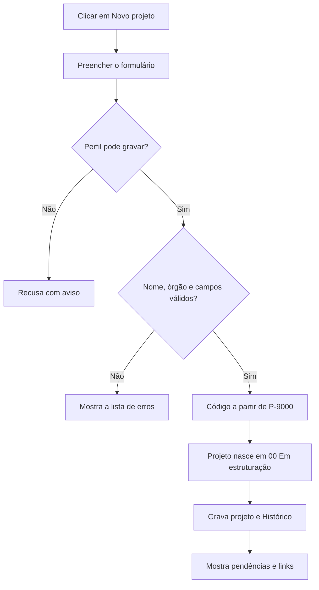

### 3.1.2 Editar os dados de um projeto

- **Objetivo:** corrigir ou completar o cadastro, deixando rastro de quem mudou o quê.
- **Quem executa (perfil/permissão):** Administrador, Gestor ou Editor.
- **Gatilho:** formulário de edição na aba Cadastro da ficha do projeto.
- **Fluxo início → meio → fim:**
  1. A ficha abre com o número da versão do projeto.
  2. A pessoa altera campos e, se quiser, escreve o motivo.
  3. O servidor valida só os campos enviados e compara com o que já existe.
  4. Se nada mudou, não grava nada.
  5. Se mudou, grava, soma 1 à versão e registra no Histórico cada campo com o valor antes e depois.
  6. A ficha recarrega com "Alterações salvas e registradas no Histórico".
- **Regras de negócio e validações:**
  - Mudar valor ou prioridade exige motivo.
  - A macroetapa não muda por aqui, só pela movimentação de etapa (3.1.3).
  - Se outra pessoa alterou o projeto no meio, a gravação é recusada: "O projeto foi alterado por outra pessoa enquanto você editava".
  - Valores captado, contrapartida, executado e total não aparecem no formulário. **[VERIFICAR]** como o "valor executado" (exigido para ir à etapa 06) é informado hoje.
- **Notificações e integrações:** nenhuma.
- **Origem:** `src/pages/plataforma/projeto/editar/[id].ts`, `src/lib/carteira/edicao.ts`, `src/lib/carteira/movimentacao.ts` (`aplicarEvento`, tipo `atualizar_campos`).

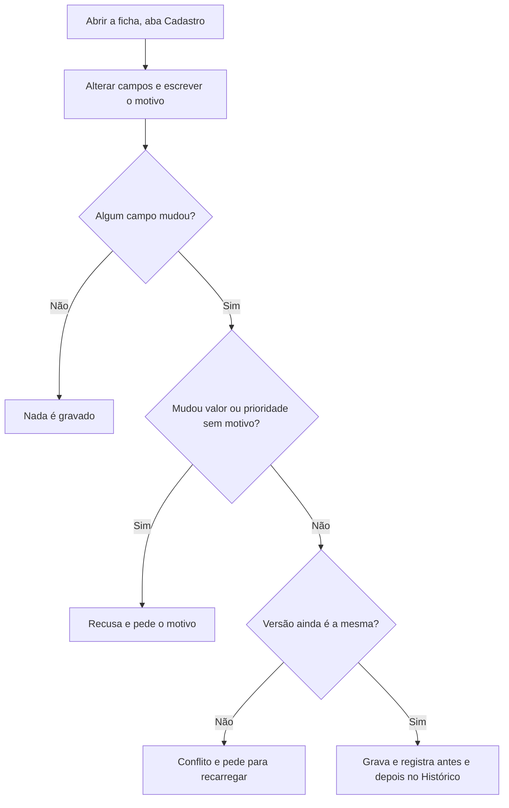

### 3.1.3 Mover o projeto de macroetapa, com portão

- **Objetivo:** fazer o projeto avançar ou voltar no ciclo sem pular requisitos sem registro.
- **Quem executa (perfil/permissão):** Administrador, Gestor ou Editor pelo Kanban. Pela tela Pendências de etapa, só Administrador e Gestor (exige também "aprovar etapa").
- **Gatilho:** botão "Mover" ou arrastar o cartão no Kanban; ou os botões da tela Pendências de etapa (3.3.6).
- **Fluxo início → meio → fim:**
  1. A pessoa escolhe a etapa de destino e, quando pedido, escreve o motivo.
  2. O servidor confere perfil, banco, formato, tamanho (até 4 KB), a versão do projeto e a etapa em que a pessoa o viu.
  3. Aplica a regra de movimentação (abaixo).
  4. Se faltam requisitos para avançar, responde com a lista do que falta e a tela oferece **"Forçar com motivo"**.
  5. Se está tudo certo, grava a nova etapa e o registro no Histórico de uma só vez. Se alguém mexeu antes, responde conflito.
  6. O cartão muda de coluna. Ao chegar em 06 – Conclusão, sai do Kanban.
- **Regras de negócio e validações** (confirmadas no código):
  - Etapas: 00 Em estruturação; 01 Planejamento; 02 Preparatório para Contratação; 03 Contratação; 04 Mobilização; 05 Execução; 06 Conclusão.
  - Projeto sem etapa só pode ir para 00, e com motivo.
  - Voltar etapa: exige motivo.
  - Avançar mais de uma etapa: só forçando, com motivo.
  - Avançar uma etapa: precisa cumprir o **portão** da etapa de destino, ou forçar com motivo:
    - para 01: nome e órgão;
    - para 02: valor da obra (ou total), origem do valor e data de entrega das peças técnicas;
    - para 03: "tem projeto = sim", origem do recurso e, se o recurso for federal, termo de compromisso;
    - para 04: tipo de contratação e data prevista de contratação;
    - para 05: data prevista de mobilização;
    - para 06: valor executado.
  - Toda mudança forçada fica marcada como "forçada" no Histórico e aparece no filtro "Somente exceções".
  - Motivo até 500 caracteres.
  - Pelas Pendências de etapa, o projeto só anda ou volta uma etapa por vez.
  - Só o Kanban e as Pendências de etapa movem projetos. O SEI não move etapa em produção (é simulação, 3.6.6).
- **Notificações e integrações:** nenhuma.
- **Origem:** `src/lib/carteira/mover.ts` (`moverProjeto`, `ORIGENS_MOVER`), `src/lib/carteira/movimentacao.ts` (`portaoPara`, `aplicarEvento`), `src/pages/plataforma/projeto/mover/[id].ts`, `src/lib/repositorio/d1.ts`.

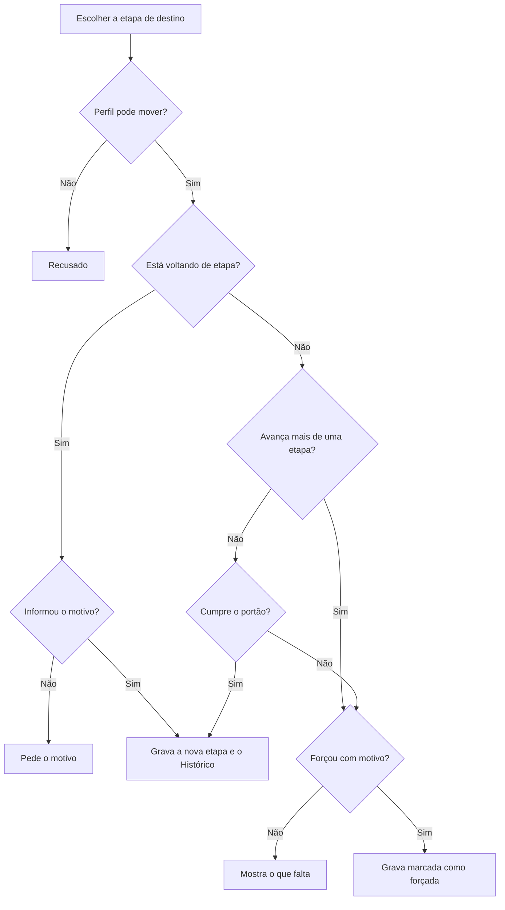

### 3.1.4 Consultar a carteira, filtrar e imprimir

- **Objetivo:** ver a carteira por etapa, valor e data de entrega e levar para reunião em papel ou PDF.
- **Quem executa (perfil/permissão):** qualquer perfil.
- **Gatilho:** abrir Carteira de projetos, Kanban ou Gantt.
- **Fluxo início → meio → fim:**
  1. A tela carrega os projetos da prefeitura da pessoa.
  2. Lê os filtros do endereço (nome ou código, órgão, área, macroetapa, período de entrega; na Carteira, também "Só prioritários").
  3. Ignora filtro inválido, com aviso.
  4. Agrupa por macroetapa e soma quantidade e valor.
  5. A pessoa abre os detalhes ou a ficha; o link guarda a tela de origem para voltar com os filtros.
  6. "Imprimir ou salvar em PDF" sai com data, hora e filtros no cabeçalho.
- **Regras de negócio e validações:**
  - Valor do projeto = valor total; se não houver, valor da obra. Projeto sem valor entra na contagem e aparece como "fora da soma".
  - Data de entrega = entrega final; se não houver, mobilização mais os dias de execução.
  - Ordem: entrega mais próxima primeiro; sem data, por último.
  - Busca até 80 caracteres; período invertido é corrigido com aviso.
  - O Gantt mostra de jan/2026 a dez/2029 e não move nada. **[VERIFICAR]** se o limite fixo é intencional.
- **Notificações e integrações:** nenhuma.
- **Origem:** `src/lib/carteira/filtros.ts`, `src/lib/carteira/lista.ts`, `src/lib/carteira/visoes.ts`, `src/components/carteira/CarteiraProjetos.astro`, `src/components/carteira/Gantt.astro`.

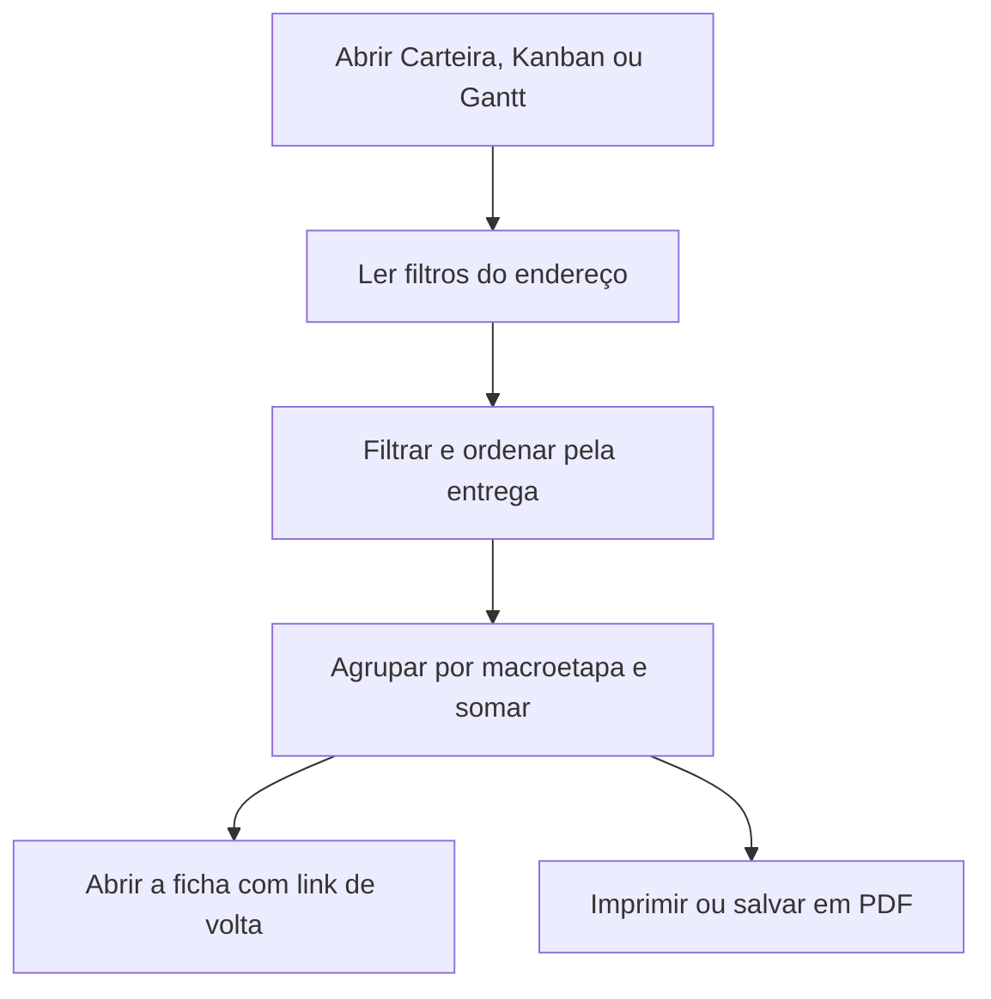

## 3.2 Localização, mapa, fotos e documentos

### 3.2.1 Cadastrar a localização da obra, com busca por endereço

- **Objetivo:** fazer a obra aparecer no ponto certo do mapa, como um ponto ou como trechos de rua.
- **Quem executa (perfil/permissão):** Administrador, Gestor ou Editor ("editar projeto"). Leitura só vê.
- **Gatilho:** aba Localização da ficha, muitas vezes vinda da lista "Obras sem localização" (3.2.2).
- **Fluxo início → meio → fim:**
  1. Abrir a aba Localização. Se o bairro é conhecido, o mapa já abre nele.
  2. Escolher "Um ponto" ou "Ruas e trechos".
  3. Opcional: digitar rua, endereço ou bairro em "Procurar no mapa". Aparecem até 5 resultados.
  4. Escolher um resultado e clicar "Usar este local" (ponto) ou "Centralizar o mapa aqui" (trechos). A busca não grava nada.
  5. Ajustar clicando no mapa, arrastando o ícone ou digitando latitude e longitude.
  6. Clicar "Salvar localização". O servidor confere de novo, grava e registra no Histórico ("Localização cadastrada" ou "alterada").
- **Regras de negócio e validações:**
  - O ponto precisa estar em Goiânia e entorno (cerca de 10 km de margem).
  - Trechos: de 1 a 20, cada um com nome de rua e de 2 a 200 pontos.
  - Sem diferença em relação ao que já existe, nada é gravado.
  - Busca: texto de 3 a 120 caracteres; até 10 buscas por minuto por pessoa; resultados guardados por 24 horas; no máximo 1 consulta por segundo ao serviço de mapas.
  - O texto digitado é enviado ao OpenStreetMap; a tela avisa para digitar só o endereço da obra.
- **Notificações e integrações:** OpenStreetMap (busca e mapa) e Esri (imagem de satélite).
- **Origem:** `src/components/carteira/ficha/LocalizacaoFicha.astro`, `src/components/mapa/EditorLocalizacao.astro`, `src/lib/mapa/geo.ts` (`validarLocalizacao`), `src/lib/mapa/servico.ts`, `src/lib/mapa/busca-endereco.ts`, `src/lib/mapa/busca-endereco-regras.ts`, `src/pages/plataforma/projeto/localizacao/[id].ts`, `src/pages/plataforma/localizacao/buscar.ts`.

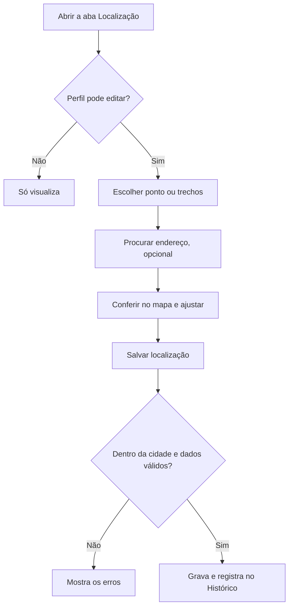

### 3.2.2 Achar e corrigir obras sem localização

- **Objetivo:** listar as obras que não aparecem no mapa e levar a equipe a cadastrá-las.
- **Quem executa (perfil/permissão):** qualquer pessoa logada consulta; a correção segue 3.2.1.
- **Gatilho:** link "Cadastrar localização" no bloco do mapa (a tela "Obras sem localização" fica fora do menu).
- **Fluxo início → meio → fim:**
  1. Para cada obra, o sistema tenta nesta ordem: localização cadastrada válida; centro do bairro; nada.
  2. As obras sem posição aparecem em "Bairro não encontrado no mapa" (por bairro) e "Sem bairro na planilha".
  3. Cada item leva à aba Localização da ficha.
- **Regras de negócio e validações:** obra posicionada só pelo centro do bairro aparece com contorno tracejado ("local aproximado"). Localização gravada que não passa na validação é ignorada sem aviso.
- **Notificações e integrações:** os centros dos bairros vêm da tabela de bairros, preenchida por um programa da equipe técnica que consulta o OpenStreetMap.
- **Origem:** `src/pages/plataforma/projetos-localizacao/index.astro`, `src/lib/mapa/pendentes.ts`, `src/lib/mapa/geo.ts` (`localizarProjeto`), `scripts/geocodificar-bairros.ts`.

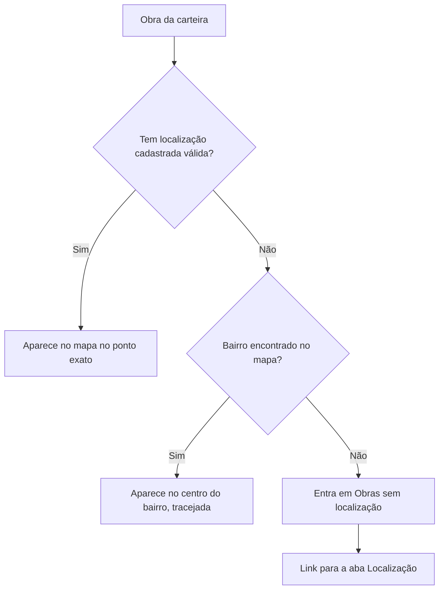

### 3.2.3 Consultar o mapa das obras

- **Objetivo:** mostrar à gestão onde estão as obras, por área, etapa e região.
- **Quem executa (perfil/permissão):** qualquer perfil (só leitura).
- **Gatilho:** abrir Mapa e painel ou a tela inicial (mapa compacto).
- **Fluxo início → meio → fim:**
  1. O mapa abre na cidade inteira, com bolhas por região.
  2. Ao aproximar, aparecem bolhas por bairro e depois cada obra.
  3. A pessoa filtra por macroetapa, área e região.
  4. Tocar numa obra abre um resumo; "Abrir em página inteira" leva à ficha.
  5. "Apresentar mapa" abre em tela cheia; Esc sai. No mapa compacto, "Ampliar mapa" faz o mesmo.
- **Regras de negócio e validações:** a cor é a da área da obra; o mapa não mostra situação de prazo. O percentual executado só aparece quando faz sentido (executado não maior que o total). O estado do mapa (filtros, zoom) fica no endereço, para compartilhar.
- **Notificações e integrações:** imagens do OpenStreetMap e da Esri.
- **Origem:** `src/components/mapa/MapaObras.astro`, `src/lib/mapa/obras.ts`, `src/lib/mapa/cores-area.ts`, `src/lib/mapa/link.ts`.

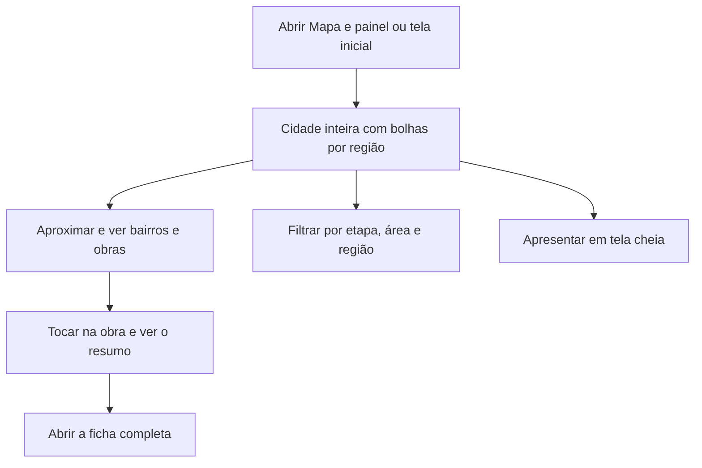

### 3.2.4 Enviar, ver e remover fotos da obra

- **Objetivo:** guardar o registro fotográfico da obra, com data e legenda.
- **Quem executa (perfil/permissão):** enviar e remover: Administrador, Gestor e Editor; ver: todos.
- **Gatilho:** aba Fotos da ficha.
- **Fluxo início → meio → fim:**
  1. Escolher o arquivo, escrever a legenda e confirmar a data da foto (vem preenchida com hoje).
  2. Clicar "Enviar foto". O servidor confere perfil, tipo, tamanho, data e limites.
  3. O arquivo vai para o armazenamento de arquivos e o registro para o banco, com linha no Histórico ("Foto enviada").
  4. A foto aparece na grade; clicar amplia.
  5. "Remover" (com confirmação) tira a foto da ficha e registra "Foto removida". O arquivo continua guardado para auditoria.
- **Regras de negócio e validações:**
  - Só JPG, PNG ou WEBP, até 10 MB; o conteúdo real precisa bater com a extensão.
  - Legenda até 200 caracteres. Data obrigatória, de 01/01/2000 até hoje.
  - A mesma foto não pode ser enviada duas vezes no mesmo projeto.
  - Até 200 fotos ativas por projeto e 60 envios por pessoa por hora.
  - A tela avisa que a foto pode guardar a posição GPS do celular.
- **Notificações e integrações:** armazenamento Cloudflare R2.
- **Origem:** `src/components/carteira/ficha/FotosFicha.astro`, `src/lib/fotos/regras.ts`, `src/lib/fotos/servico.ts`, `src/lib/fotos/repositorio.ts`, `src/pages/plataforma/fotos-projeto/`, `db/d1/prefeitura/0008_foto_projeto.sql`.

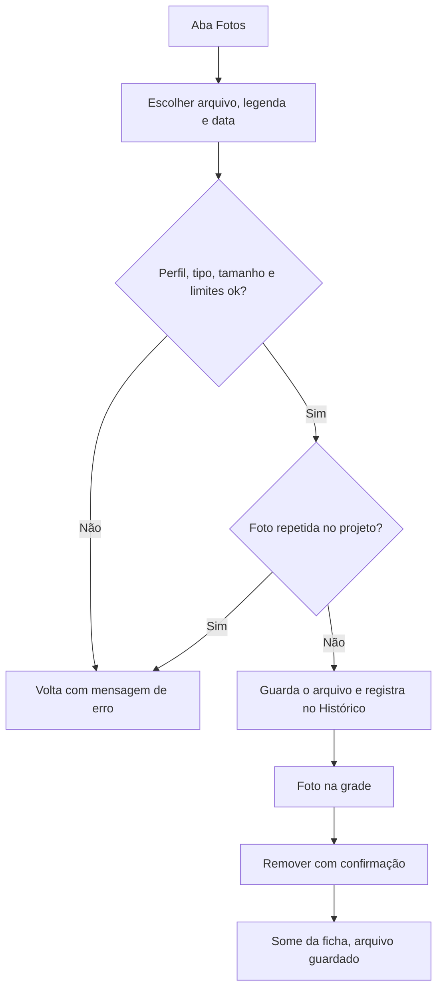

### 3.2.5 Enviar, classificar, baixar e remover documentos

- **Objetivo:** guardar os documentos do projeto (DFD, ETP, TR e outros) num lugar só, com tipo.
- **Quem executa (perfil/permissão):** enviar, classificar e remover: Administrador, Gestor e Editor ("enviar documento"); ver e baixar: todos.
- **Gatilho:** link "Abrir os documentos do projeto" na ficha, ou a tela Documentos com escolha do projeto.
- **Fluxo início → meio → fim:**
  1. Escolher o arquivo e, se quiser, o tipo. Clicar "Enviar".
  2. O servidor confere perfil, tamanho, tipo, conteúdo e se o mesmo arquivo já está no projeto.
  3. O arquivo é guardado e a página volta com "Documento enviado".
  4. Na lista, cada documento pode ser baixado; quem grava vê "Salvar tipo" e "Remover".
  5. Trocar o tipo registra no Histórico o tipo antigo e o novo.
  6. Remover tira da lista; o arquivo e o registro ficam guardados para auditoria.
- **Regras de negócio e validações:**
  - Aceita PDF, imagens (PNG, JPG, WEBP) e arquivos de Office (DOC, DOCX, XLS, XLSX, PPTX), até 25 MB.
  - O mesmo conteúdo não pode estar ativo duas vezes no projeto.
  - Até 30 envios por pessoa por hora.
  - Tipos: DFD, ETP e TR sempre ativos; Mapa de riscos, Projeto básico, Orçamento de referência, ART e Licença ambiental nascem desativados. Tipos nunca se apagam, só se desativam. **[VERIFICAR]** não há tela para ativar tipos.
  - Download sempre como anexo (o navegador não abre o arquivo como página).
  - Enviar e remover documento não gera linha no Histórico; só a troca de tipo gera. **[VERIFICAR]** se é intencional (as fotos registram as duas coisas).
- **Notificações e integrações:** armazenamento Cloudflare R2.
- **Origem:** `src/pages/plataforma/documentos-projeto/`, `src/lib/documentos/servico.ts`, `src/lib/documentos/regras.ts`, `src/lib/documentos/repositorio.ts`, `db/d1/prefeitura/0003_tipo_documento.sql`.

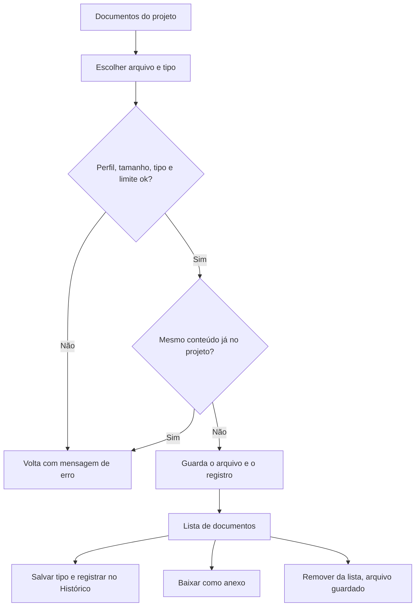

## 3.3 Cronogramas e governança da execução

### 3.3.1 Criar o cronograma e montar as tarefas

- **Objetivo:** manter o cronograma de cada projeto direto no sistema.
- **Quem executa (perfil/permissão):** Administrador, Gestor ou Editor.
- **Gatilho:** botão "Novo cronograma" na lista de Cronogramas ou "Criar o cronograma deste projeto" na ficha.
- **Fluxo início → meio → fim:**
  1. Escolher um projeto que ainda não tem cronograma e, se quiser, um título.
  2. O sistema cria o cronograma vazio e registra no Histórico do projeto.
  3. Na aba "Tarefas e responsáveis", incluir tarefas (nome e fase obrigatórios).
  4. Conforme o trabalho anda: editar datas, usar "Iniciar hoje" e "Concluir hoje", subir ou descer tarefas e fases, trocar responsável (3.3.3) ou remover tarefa.
  5. Cada mudança vira um registro no Histórico.
- **Regras de negócio e validações:**
  - Um cronograma por projeto; tentar de novo leva ao existente.
  - Até 500 tarefas por cronograma.
  - Fim previsto não pode ser antes do início previsto; fim real não pode ser antes do início real; não há fim real sem início real; datas reais não podem estar no futuro.
  - Tarefa removida não volta; inclui-se uma nova.
  - Se outra pessoa alterou o cronograma antes, a gravação é recusada e pede para recarregar.
- **Notificações e integrações:** nenhuma.
- **Origem:** `src/pages/plataforma/cronograma/novo.astro`, `src/pages/plataforma/cronograma/criar.ts`, `src/pages/plataforma/cronograma/gravar/[id].ts`, `src/lib/cronograma/edicao.ts`, `src/lib/cronograma/planejar.ts` (`MAX_TAREFAS`), `src/lib/cronograma/http.ts`.

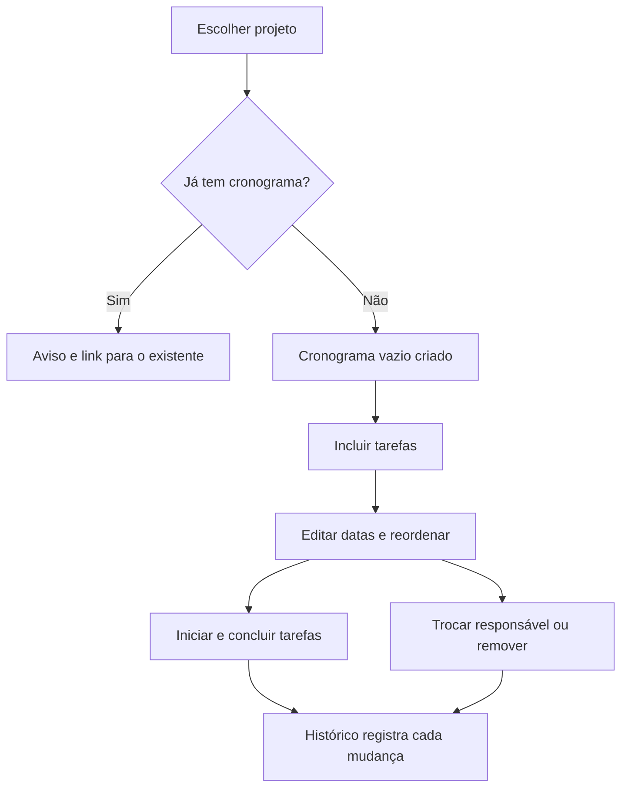

### 3.3.2 A tela vence a planilha

- **Objetivo:** impedir que uma nova carga da planilha apague o que a equipe fez na tela.
- **Quem executa (perfil/permissão):** automático. A marca nasce na primeira gravação pela tela.
- **Gatilho:** criar o cronograma pela tela ou gravar qualquer mudança nele.
- **Fluxo início → meio → fim:**
  1. O cronograma nasce da planilha ou da tela.
  2. Na primeira gravação pela tela, ganha a marca "editado na tela". A marca nunca é retirada.
  3. Nas cargas seguintes, a planilha não altera nem apaga esse cronograma.
- **Regras de negócio e validações:** cronograma editado na tela não pode ser apagado; suas tarefas só saem pela tela. Isso também impede limpezas administrativas, que exigirão uma migração própria.
- **Notificações e integrações:** carga da planilha de cronogramas (3.9.3).
- **Origem:** `db/d1/prefeitura/0009_cronograma_na_tela.sql`, `scripts/gerar-sql-carga.ts`, `scripts/importar-cronogramas.ts`.

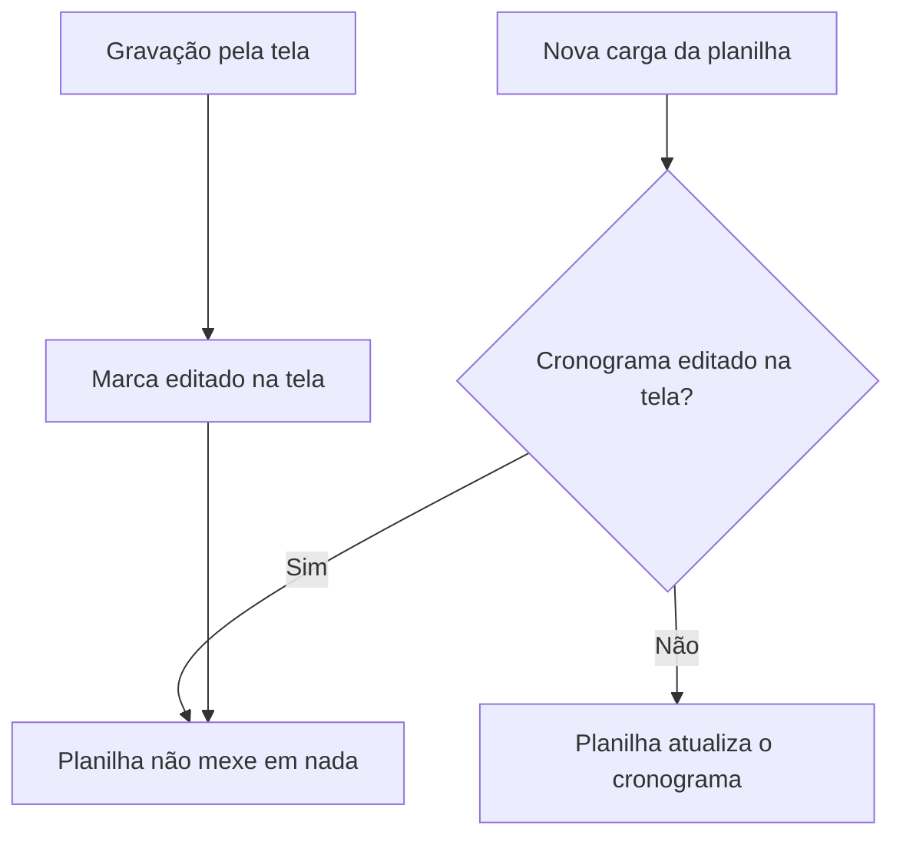

### 3.3.3 Trocar o responsável de uma tarefa

- **Objetivo:** saber com quem a tarefa esteve em cada período, sem perder o rastro.
- **Quem executa (perfil/permissão):** Administrador, Gestor ou Editor.
- **Gatilho:** botão "Trocar responsável" na tarefa (some quando a tarefa está concluída).
- **Fluxo início → meio → fim:**
  1. Informar o novo responsável e/ou a área, a data da troca e, se quiser, o motivo.
  2. O sistema grava uma linha no histórico de responsáveis ("inicial", se a tarefa não tinha ninguém; "troca", nos demais casos).
  3. O responsável atual da tarefa muda e o tempo na mão passa a contar por passagem (3.3.4).
  4. "Histórico de responsáveis" mostra cada passagem, os dias e quem registrou.
- **Regras de negócio e validações** (confirmadas no código):
  - Tarefa concluída: é preciso apagar o fim real para reabrir antes de trocar.
  - A data da troca não pode ser no futuro, nem antes de 01/01/2000, nem antes do início real da tarefa, nem antes da última troca.
  - É preciso informar responsável ou área; se forem iguais aos atuais, a troca é recusada.
  - O histórico de responsáveis não se altera nem se apaga; para corrigir, registra-se nova troca.
- **Notificações e integrações:** nenhuma; vira registro no Histórico.
- **Origem:** `src/lib/cronograma/planejar.ts` (`trocar_responsavel`), `db/d1/prefeitura/0009_cronograma_na_tela.sql` (tabela de trocas), `src/components/cronograma/TarefasResponsaveis.astro`.

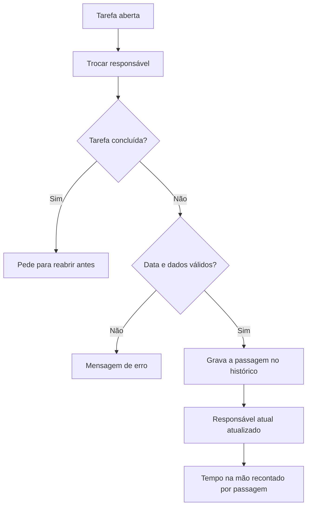

### 3.3.4 Situação da tarefa, tempo na mão e alertas

- **Objetivo:** mostrar o estado real da tarefa sem ninguém digitar "status": ele sai das datas.
- **Quem executa (perfil/permissão):** automático; todos veem.
- **Gatilho:** abrir qualquer tela de cronograma.
- **Fluxo início → meio → fim:**
  1. Com fim real: **Concluída**. Com início real e hoje depois do fim previsto: **Atrasada**. Com início real: **Em andamento**. Sem início real e hoje depois do início previsto: **Início atrasado**. Senão: **A fazer**.
  2. O tempo na mão começa no início real e para no fim real; com trocas, cada responsável tem a sua passagem.
  3. Alerta **Atenção** quando os dias passam da duração prevista; **Urgente** quando passam do dobro.
- **Regras de negócio e validações:** alerta só para tarefa aberta, iniciada e com duração prevista. O ritmo do cronograma é verde a partir de 0,95 do previsto, amarelo de 0,85 a 0,95 e vermelho abaixo de 0,85.
- **Notificações e integrações:** os atrasos alimentam a Central de alertas (3.5.1); nada é enviado.
- **Origem:** `src/lib/cronograma/visoes.ts` (`statusNaData`, `farolRitmo`), `src/lib/cronograma/responsaveis.ts` (`tempoNaMao`, `alertaDoTempo`).

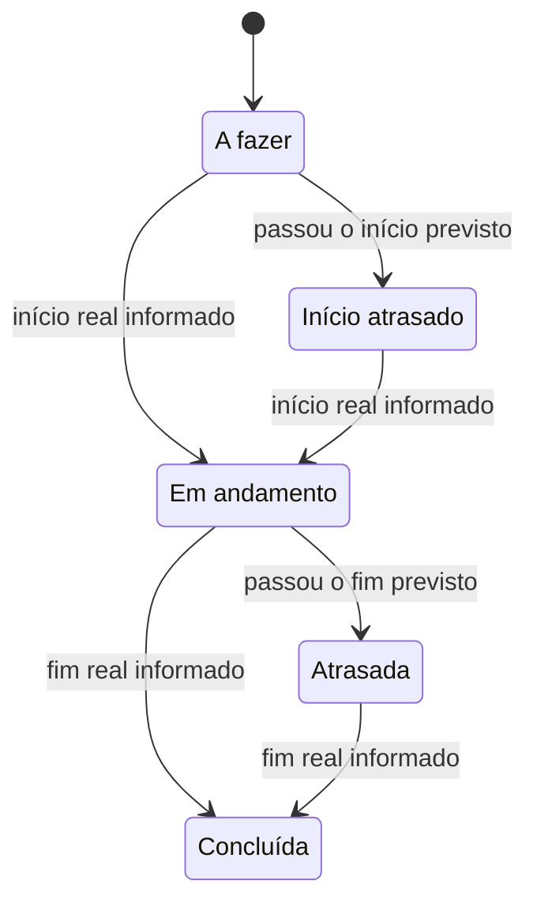

### 3.3.5 Painel Responsáveis

- **Objetivo:** mostrar à chefia com quem está cada tarefa e há quantos dias.
- **Quem executa (perfil/permissão):** qualquer perfil; só leitura.
- **Gatilho:** menu Governança da execução › Responsáveis.
- **Fluxo início → meio → fim:**
  1. A tela reúne só as tarefas abertas, em três quadros: Por pessoa, Por área e Tarefas em mãos.
  2. Filtrar por área, pessoa e "Só com alerta"; clicar num nome aplica o filtro.
  3. Imprimir (cabeçalho com município, data e filtros) ou baixar o CSV com os mesmos filtros.
- **Regras de negócio e validações:** ordem por urgentes, depois atenção, depois dias; "Sem responsável" vai por último. O CSV usa ponto e vírgula, abre acentuado no Excel e protege cada célula contra fórmulas.
- **Notificações e integrações:** nenhuma.
- **Origem:** `src/lib/cronograma/painel-responsaveis.ts`, `src/pages/plataforma/gestao-responsaveis/index.astro`, `src/pages/plataforma/gestao-responsaveis/csv.ts`.

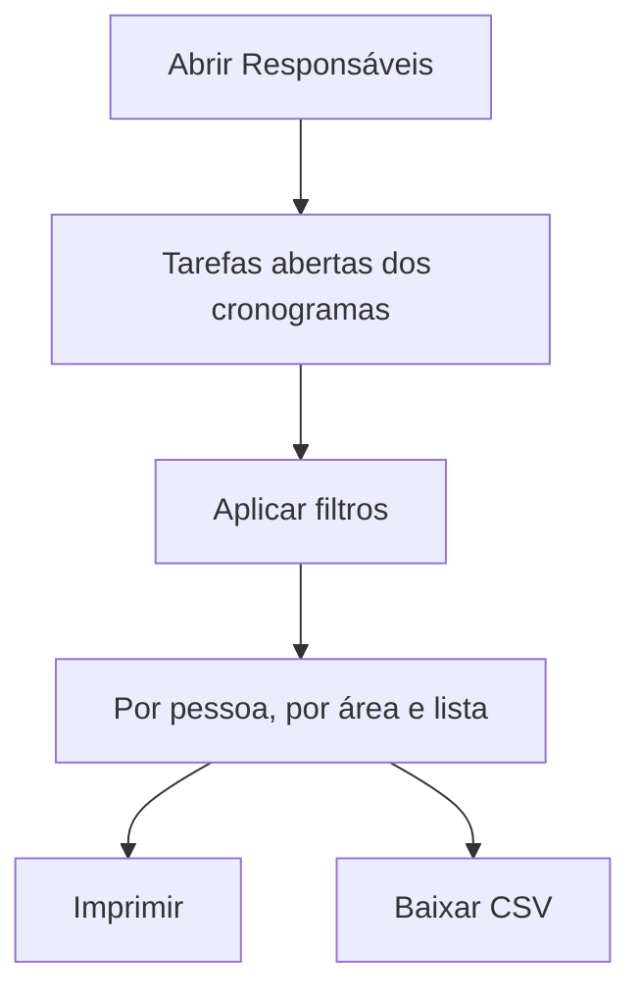

### 3.3.6 Pendências de etapa

- **Objetivo:** concentrar os projetos que aguardam aprovação para mudar de macroetapa.
- **Quem executa (perfil/permissão):** Administrador e Gestor ("editar projeto" e "aprovar etapa"). Editor e Leitura só consultam.
- **Gatilho:** menu Governança da execução › Pendências de etapa.
- **Fluxo início → meio → fim:**
  1. A tela lista os projetos que não estão em 06, por macroetapa, com o que falta para a próxima.
  2. **Aprovar**: tenta avançar uma etapa sem motivo. Se falta requisito, abre o diálogo com a lista e a opção de forçar.
  3. **Reprovar**: volta uma etapa; o diálogo exige motivo.
  4. **Aprovar mesmo assim**: avança com pendências; exige motivo e fica marcado como forçado.
  5. A mudança segue a mesma regra do Kanban (3.1.3) e vai ao Histórico com origem "Pendências de etapa".
- **Regras de negócio e validações:** só uma etapa por vez, para frente ou para trás; controle de versão do projeto.
- **Notificações e integrações:** nenhuma.
- **Origem:** `src/components/carteira/PendenciasEtapa.astro`, `src/lib/carteira/mover.ts` (`podeMover`, `vizinha`).

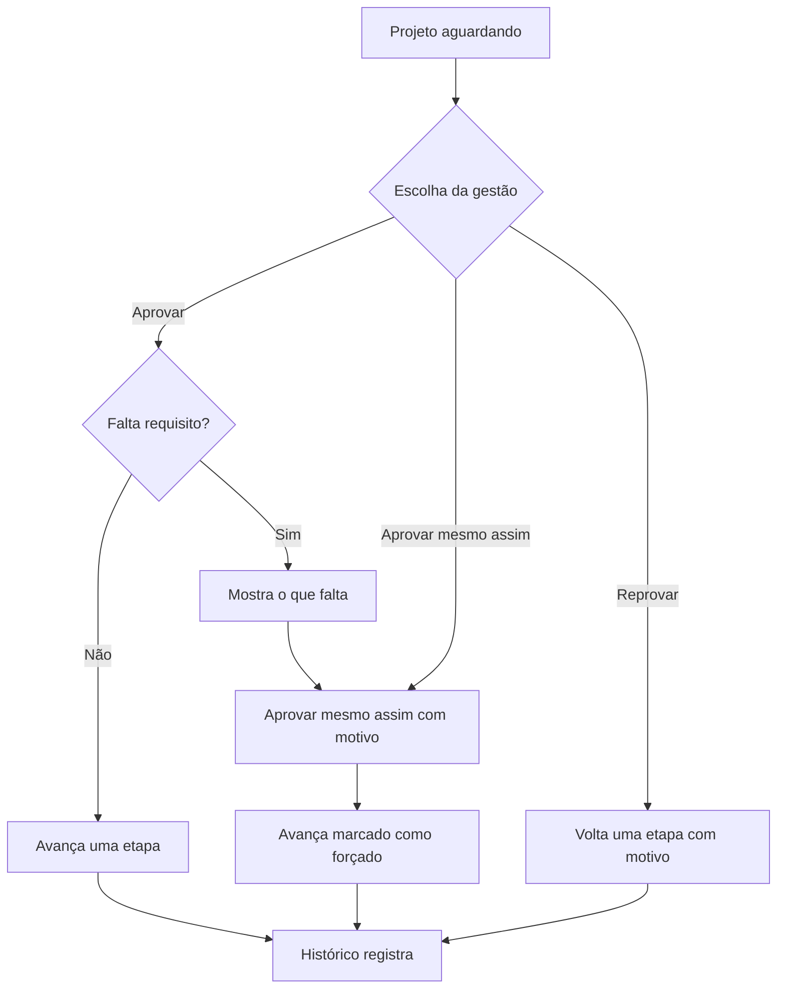

### 3.3.7 Atraso em cascata e Onde está parado

- **Objetivo:** mostrar quanto o atraso de uma etapa empurra as seguintes e qual unidade ou pessoa concentra o trabalho parado.
- **Quem executa (perfil/permissão):** automático; todos veem.
- **Gatilho:** abrir a página do cronograma (aba Dependências) ou a tela Onde está parado.
- **Fluxo início → meio → fim:**
  1. Como a planilha não diz quem depende de quem, o sistema deduz: cada etapa depende das do bloco anterior; etapas da mesma fase que se sobrepõem são paralelas.
  2. Fim projetado = fim previsto mais o maior atraso herdado das anteriores.
  3. A página mostra o fim projetado, os dias de atraso, a etapa gargalo e quantas etapas estão travadas.
  4. Onde está parado soma, por unidade e por responsável, as etapas com prazo vencido (fim previsto vencido, ou início previsto vencido sem início), com os dias e a mais antiga.
- **Regras de negócio e validações:** etapa sem data prevista não entra no cálculo. A pessoa não consegue informar uma dependência real pela tela.
- **Notificações e integrações:** os números alimentam a Central de alertas e os painéis.
- **Origem:** `src/lib/cronograma/dependencias.ts`, `src/lib/cronograma/visoes.ts` (`itensParados`, `ondeEstaParado`), `src/components/cronograma/Parado.astro`.

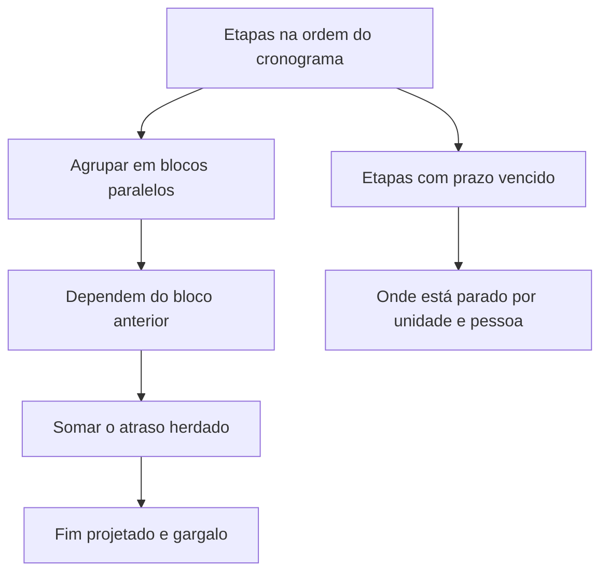

## 3.4 Visão gerencial

### 3.4.1 Acompanhar a carteira na tela inicial

- **Objetivo:** dar ao prefeito uma visão simples: quantas obras, quanto valem, em que etapa estão e quando serão entregues.
- **Quem executa (perfil/permissão):** qualquer perfil; só leitura.
- **Gatilho:** abrir a plataforma (Projetos prioritários é a primeira tela após o login).
- **Fluxo início → meio → fim:**
  1. A tela lê a carteira, as áreas e a data de hoje (horário de Brasília).
  2. Lê os filtros do endereço (Só prioritários, etapa, área, órgão, região, período); filtro inválido é ignorado com aviso.
  3. Calcula obras e valor por etapa, obras por área, linha do tempo de entregas, próximas entregas (até 8) e principais obras (até 5).
  4. Cada número é clicável: clicar aplica o filtro; clicar de novo retira.
  5. Cada obra abre a ficha, com volta para a tela e os filtros.
- **Regras de negócio e validações:** 04 e 05 contam como Execução; 03 Contratação; 02 Preparatório; 01 Planejamento; 00 Estruturação; 06 Concluídas. A linha do tempo vai até dez/2028 e ignora concluídos. Esta tela não mostra cores de prazo.
- **Notificações e integrações:** nenhuma.
- **Origem:** `src/lib/gestao/prioritarios.ts`, `src/components/gestao/ProjetosPrioritarios.astro`, `src/pages/plataforma/index.astro`.

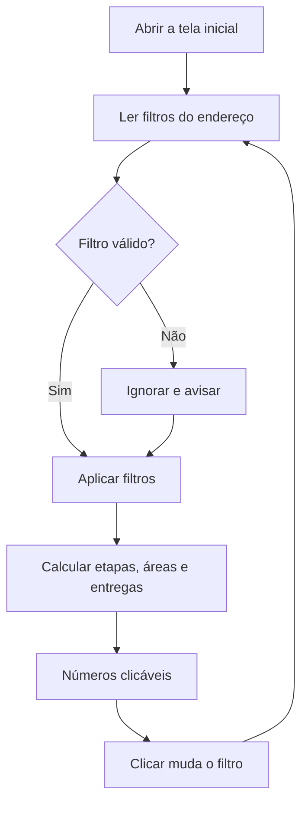

### 3.4.2 Regra do prazo da macroetapa

- **Objetivo:** dizer se o projeto está dentro ou fora do prazo da etapa atual.
- **Quem executa (perfil/permissão):** cálculo automático; ninguém grava.
- **Gatilho:** abrir Mapa e painel, Painel da equipe, Inconsistências, Reunião semanal ou Sala de guerra.
- **Fluxo início → meio → fim:**
  1. Cada macroetapa tem uma data prevista de saída: 00 peças técnicas; 01 planejamento; 02 preparatório; 03 contratação; 04 mobilização; 05 encerramento. A 06 não tem prazo.
  2. O sistema compara essa data com hoje.
  3. Se já passou, o prazo está vencido e os dias de atraso são a diferença.
- **Regras de negócio e validações:**
  - Projeto concluído nunca está vencido. Projeto sem a data da etapa atual não é marcado como vencido; vira inconsistência "Datas previstas faltando".
  - Hoje o código ainda classifica em cores (o "farol"): vermelho se o prazo da etapa ou a entrega venceu; amarelo se há pendência de dado ou o prazo vence em até 15 dias; verde no resto. **[VERIFICAR]** O farol será retirado (decisão do dono, E19, ainda não publicada).
- **Notificações e integrações:** nenhuma.
- **Origem:** `src/lib/carteira/visoes.ts` (`farol`, `fimDaMacroetapaAtual`), `src/lib/carteira/macroetapas.ts`.

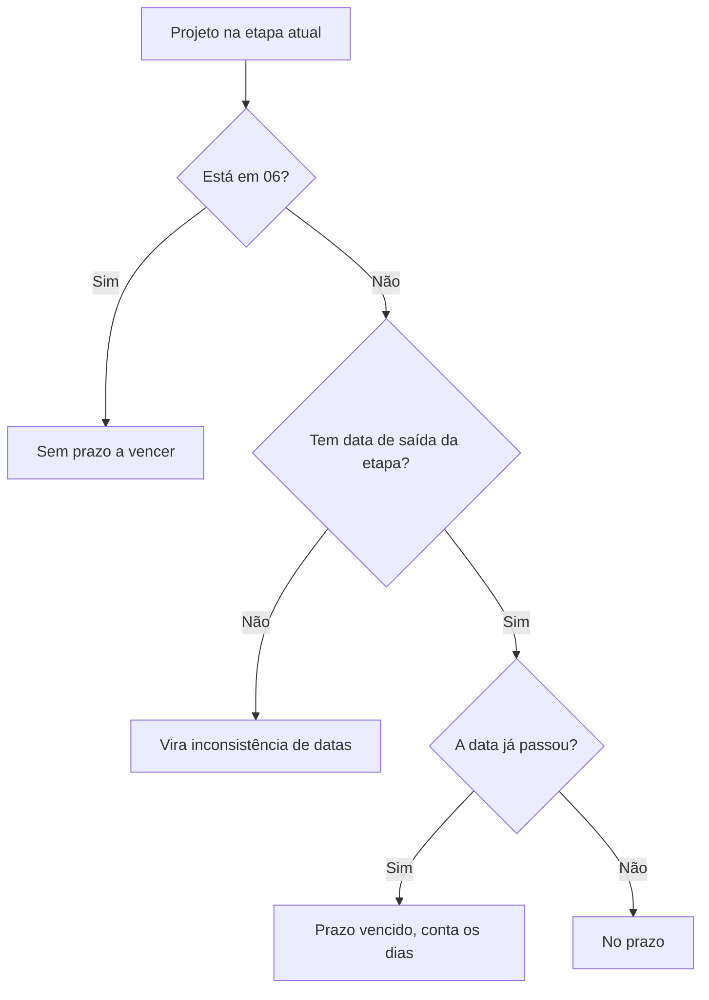

### 3.4.3 Corrigir inconsistências de dados

- **Objetivo:** achar dados incompletos ou errados e levar a equipe até a ficha para corrigir.
- **Quem executa (perfil/permissão):** Administrador, Gestor e Editor. Leitura recebe "sem permissão" e não vê o item no menu.
- **Gatilho:** menu Governança da execução › Inconsistências.
- **Fluxo início → meio → fim:**
  1. O sistema roda 10 regras em todos os projetos.
  2. A equipe filtra por órgão e/ou regra.
  3. Clica no projeto: abre a aba Governança da ficha, com volta ao relatório.
  4. Corrige na ficha; ao reabrir o relatório, o item some.
  5. Opcional: imprimir em A4 ou baixar o CSV.
- **Regras de negócio e validações:** as 10 regras são sem órgão, sem área, sem valor, sem macroetapa, datas faltando, datas fora de ordem, macroetapa vencida, SEI fora do formato, sem localização e outras pendências da carga.
- **Notificações e integrações:** nenhuma.
- **Origem:** `src/lib/gestao/inconsistencias.ts` (`REGRAS`), `src/lib/gestao/inconsistencias-carga.ts`, `src/pages/plataforma/gestao-inconsistencias/`.

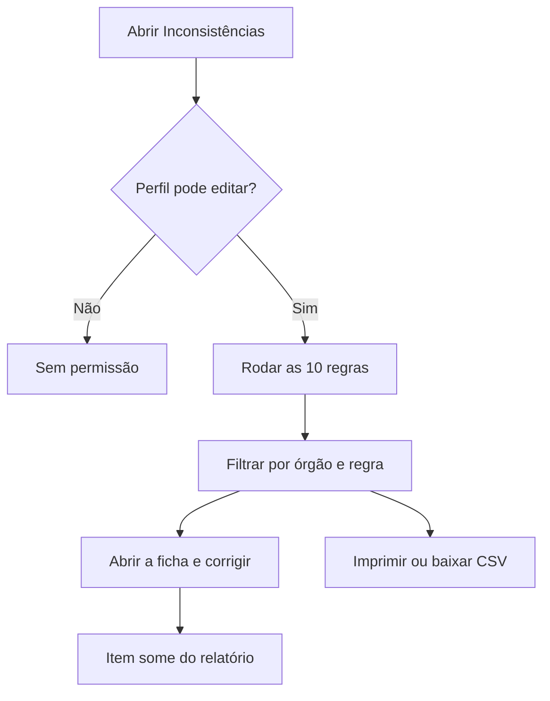

### 3.4.4 Reunião semanal [DEMONSTRATIVO]

- **Objetivo:** o sistema monta a pauta da semana; a equipe discute, decide e anota ações.
- **Quem executa (perfil/permissão):** qualquer pessoa logada; a tela não confere perfil. **[VERIFICAR]** se Leitura deve só ver.
- **Gatilho:** abrir Reunião semanal.
- **Fluxo início → meio → fim:**
  1. Informar a data da última reunião (padrão: 7 dias atrás).
  2. O sistema lista os projetos com motivo: prazo vencido, candidato à sala de guerra, mudou desde a última reunião ou prioridade muito alta em atenção.
  3. A equipe marca os discutidos e preenche discussão, decisão e ações.
  4. "Registrar reunião (simulação)" guarda só no navegador; "Gerar ata em PDF" imprime.
- **Regras de negócio e validações:** para registrar, ao menos um projeto discutido; cada ação precisa de descrição, responsável e prazo. Nada vai ao servidor.
- **Notificações e integrações:** nenhuma.
- **Origem:** `src/components/reuniao/ReuniaoSemanal.astro`, `src/lib/reuniao/visoes.ts`, `src/lib/reuniao/simulacao.ts`.

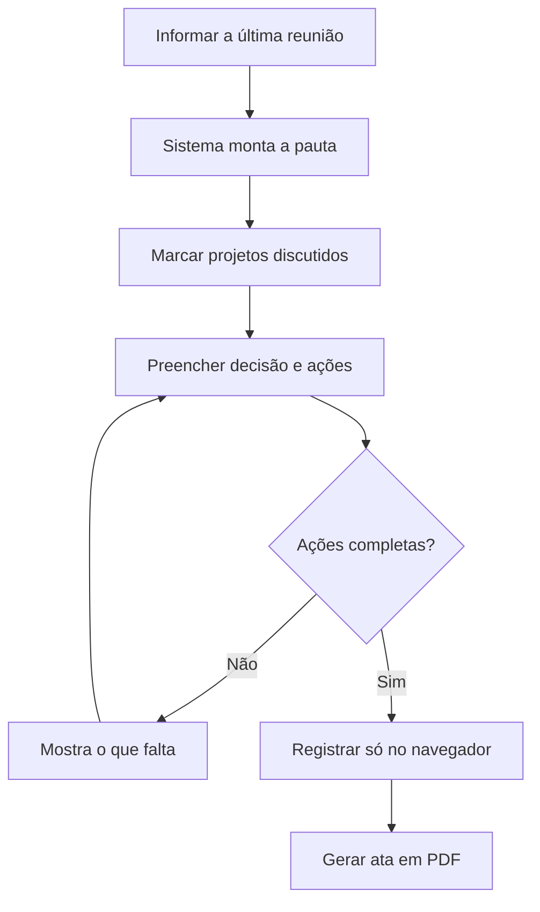

### 3.4.5 Sala de guerra [DEMONSTRATIVO]

- **Objetivo:** reunir a equipe em torno de um projeto crítico, com objetivo, prazo, dono, reuniões frequentes e quadro de riscos, ações, problemas e decisões.
- **Quem executa (perfil/permissão):** qualquer pessoa logada. **[VERIFICAR]** perfil.
- **Gatilho:** o sistema sugere "Candidatos à sala" ou a equipe decide abrir.
- **Fluxo início → meio → fim:**
  1. Em "Candidatos à sala", ver o motivo; "Abrir sala" pede tipo (crise ou missão), objetivo, prazo, cadência, escalonamento e dono.
  2. Com a sala em andamento, registrar itens e fazer reuniões com pauta automática.
  3. Ao resolver ou encerrar, guardar o resultado e as lições aprendidas.
- **Regras de negócio e validações:** candidato soma 3 pontos ou mais (por exemplo: prioridade alta com prazo vencido vale 3; etapa parada há mais de 30 dias vale 2). As salas vêm de dados de exemplo e nada é gravado.
- **Notificações e integrações:** nenhuma.
- **Origem:** `src/lib/sala/visoes.ts`, `src/lib/sala/carga.ts`, `src/components/sala/SalaGuerra.astro`, `src/pages/plataforma/sala-de-guerra/[id].astro`, `data/exemplo/sala-guerra/salas.json`.

```mermaid
stateDiagram-v2
  state "Candidato" as Candidato
  state "Aberta" as Aberta
  state "Em andamento" as EmAndamento
  state "Resolvida" as Resolvida
  state "Encerrada" as Encerrada
  [*] --> Candidato
  Candidato --> Aberta: abrir sala
  Aberta --> EmAndamento: reuniões e itens
  EmAndamento --> Resolvida: objetivo atingido
  EmAndamento --> Encerrada: encerrar
  Resolvida --> [*]
  Encerrada --> [*]
```

## 3.5 Alertas, WhatsApp e Histórico

### 3.5.1 Central de alertas

- **Objetivo:** mostrar num só lugar o que está atrasado ou perto de atrasar, com a ação recomendada.
- **Quem executa (perfil/permissão):** o sistema calcula a cada abertura; qualquer pessoa logada vê.
- **Gatilho:** menu Governança da execução › Alertas.
- **Fluxo início → meio → fim:**
  1. O sistema lê carteira, cronogramas, convênios coletados e a atualidade das fontes.
  2. Aplica as regras de cada tipo e calcula os dias corridos e úteis até o prazo.
  3. Ordena: vermelho primeiro; dentro da cor, o prazo mais antigo primeiro.
  4. Mostra totais, cartões por tipo, lista com filtros e a seção "Ainda sem fonte de dados".
- **Regras de negócio e validações:**
  - Gravidade **vermelho** (grave) ou **amarelo** (atenção).
  - Convênio sem desembolso há mais de 180 dias; vigência em até 90 dias (vermelho com 30 ou menos, ou vencida).
  - Contratação, início e fim de obra: vermelho se a data passou; amarelo se faltam 30 dias ou menos.
  - Saldo sem fonte: vermelho a partir da etapa 03.
  - Etapa parada: vermelho acima de 30 dias.
  - Dado defasado: planilha sem carga há mais de 7 dias (vermelho acima de 14). **[VERIFICAR]** em produção a data da carga pode vir vazia e o alerta nunca dispara.
  - Não há como marcar alerta como resolvido: ele some quando o dado muda.
  - **[INCOMPLETO]** Prazos da Lei 14.133 e "Edital na praça" ainda não têm dado e aparecem só em "Ainda sem fonte de dados".
- **Notificações e integrações:** nenhuma; não envia e-mail nem WhatsApp.
- **Origem:** `src/lib/alertas/central.ts` (`montarCentral`), `src/components/alertas/CentralAlertas.astro`.

```mermaid
flowchart TD
  A["Abrir Alertas"] --> B["Ler carteira, cronogramas, convênios e fontes"]
  B --> C["Aplicar as regras de cada tipo"]
  C --> D{"Passou do prazo limite?"}
  D -- "Sim" --> E["Alerta vermelho"]
  D -- "Perto do prazo" --> F["Alerta amarelo"]
  D -- "Não" --> G["Sem alerta"]
  E --> H["Ordenar e mostrar com filtros"]
  F --> H
```

### 3.5.2 Relatório e perguntas por WhatsApp [DEMONSTRATIVO]

- **Objetivo:** mostrar como cada gestor receberia o resumo da carteira e poderia fazer perguntas, vendo só o que a sua permissão libera.
- **Quem executa (perfil/permissão):** qualquer pessoa logada usa a simulação.
- **Gatilho:** menu Conta › WhatsApp; escolher um número em "Ver como".
- **Fluxo início → meio → fim:**
  1. A lista começa com 3 números fictícios.
  2. Ao escolher um número, o sistema filtra primeiro os projetos que ele pode ver (órgãos, prioridade, projetos liberados) e só depois monta o texto.
  3. A pessoa digita perguntas ou usa as sugestões ("Relatório", "O que está atrasado?", "Próximas entregas").
- **Regras de negócio e validações:** projeto não liberado recebe a mesma resposta de "não encontrado"; sem permissão de valores, nenhum R$ aparece; cadastro usa cargo ou equipe, nunca nome de pessoa; até 50 números. Os números ficam só na aba do navegador.
- **Notificações e integrações:** nenhuma mensagem é enviada. **[INCOMPLETO]** conta oficial do WhatsApp, registro de mensagens e banco de números.
- **Origem:** `src/components/whatsapp/WhatsAppGestao.astro`, `src/lib/whatsapp/mensagens.ts`, `src/lib/whatsapp/permissoes.ts`, `src/lib/whatsapp/simulacao.ts`.

```mermaid
flowchart TD
  A["Escolher número em Ver como"] --> B{"Número ativo?"}
  B -- "Não" --> C["Aviso de número inativo"]
  B -- "Sim" --> D["Filtrar projetos pela permissão"]
  D --> E["Montar relatório só com os liberados"]
  E --> F["Mostrar na conversa simulada"]
  F --> G["Responder pergunta entre os liberados"]
```

### 3.5.3 Histórico de alterações

- **Objetivo:** guardar de forma permanente o que mudou em cada projeto e permitir consulta e exportação.
- **Quem executa (perfil/permissão):** o registro é automático quando alguém grava; a consulta é de qualquer pessoa logada.
- **Gatilho:** qualquer gravação (mudança de etapa, campos, carga da planilha, localização, foto, tipo de documento, cronograma).
- **Fluxo início → meio → fim:**
  1. A gravação cria um registro no banco.
  2. A tela Histórico junta os registros de projeto e do sistema da prefeitura da pessoa.
  3. Mostra os mais recentes primeiro, 25 por página, com filtros (datas, projeto, pessoa, ação, origem, "Somente exceções", busca).
  4. "Ver detalhes" mostra motivo, etapa e campos antes e depois; "Exportar CSV" baixa o resultado filtrado.
- **Regras de negócio e validações:** o banco recusa alterar ou apagar registros. Cada prefeitura só vê o seu histórico. "Exceção" é movimentação forçada. O filtro "Ação" lista só 7 tipos; os demais se acham pela busca ou pela origem.
- **Notificações e integrações:** nenhuma.
- **Origem:** `src/lib/log/visoes.ts`, `src/lib/log/tipos.ts`, `src/components/log/LogAlteracoes.astro`, `db/d1/prefeitura/0001_carteira.sql`.

```mermaid
flowchart TD
  A["Alguém grava uma mudança"] --> B["Registro permanente no banco"]
  B --> C["Abrir o Histórico"]
  C --> D["Filtrar e paginar"]
  D --> E["Ver detalhes"]
  D --> F["Exportar CSV"]
```

### 3.5.4 Voltar à tela de origem

- **Objetivo:** quem abre uma tela a partir de outra volta com um clique, com os mesmos filtros.
- **Quem executa (perfil/permissão):** automático, para todos.
- **Gatilho:** clicar num link que leva a outra tela (por exemplo, do alerta para a ficha).
- **Fluxo início → meio → fim:**
  1. A tela de origem acrescenta ao link o endereço de volta.
  2. A tela de destino confere se o endereço é seguro e mostra "← Voltar para [nome da tela]".
  3. Sem endereço válido, mostra o link padrão da tela, se houver.
- **Regras de negócio e validações:** só aceita telas da própria plataforma (nunca sites externos); guarda até 2 níveis; avisos já mostrados não se repetem na volta.
- **Notificações e integrações:** nenhuma.
- **Origem:** `src/lib/navegacao/volta.ts`, `src/components/navegacao/Voltar.astro`, `src/layouts/Platform.astro`.

```mermaid
flowchart TD
  A["Tela de origem com filtros"] --> B["Link leva o endereço de volta"]
  B --> C{"Endereço seguro e é uma tela?"}
  C -- "Sim" --> D["Mostra Voltar para a tela"]
  C -- "Não" --> E["Link padrão ou nada"]
  D --> F["Volta com os mesmos filtros"]
```

## 3.6 Licitações e PNCP

### 3.6.1 Acompanhar uma contratação: etapas e marcos

- **Objetivo:** manter num só lugar a situação de cada contratação, sem planilha paralela.
- **Quem executa (perfil/permissão):** Administrador, Gestor ou Editor. Leitura só consulta.
- **Gatilho:** "Nova contratação" na Gestão das licitações, ou o atalho "Cadastrar contratação para este projeto" na ficha.
- **Fluxo início → meio → fim:**
  1. Cadastrar com nome, etapa inicial (padrão "Projeto em finalização") e data da etapa.
  2. Editar os campos na tabela ou na página da contratação.
  3. Avançar: Projeto em finalização → Em preparação → Edital em ajustes → Publicada → Em julgamento → Concluída.
  4. Registrar marcos (homologação, contrato, ordem de serviço) e concluí-los.
  5. Se preciso, remover com motivo (a linha some das listas, mas fica no banco e no Histórico).
- **Regras de negócio e validações:**
  - Nome até 200 caracteres; SEI no formato 00.0.000000000-0; projeto da carteira precisa existir.
  - Valores até 10 bilhões de reais.
  - Avançar para a etapa seguinte é livre; **pular ou voltar exige motivo**. A data da etapa não pode ser futura nem anterior à atual.
  - A etapa só muda pelo botão "Mudar etapa", não pela edição na tabela.
  - Até 50 marcos por contratação; até 5.000 contratações ativas.
  - Avisos que não bloqueiam: "Valor pago maior que o contratado", "Colocação sem empresa".
- **Notificações e integrações:** opcional, a ligação com o PNCP (3.6.2).
- **Origem:** `src/lib/contratacoes/regras.ts` (`regraMudanca`), `src/lib/contratacoes/servico.ts`, `src/pages/plataforma/gestao-licitacoes/`, `db/d1/prefeitura/0010_contratacao.sql`.

```mermaid
stateDiagram-v2
  state "Projeto em finalização" as Fin
  state "Em preparação" as Prep
  state "Edital em ajustes" as Ajus
  state "Publicada" as Pub
  state "Em julgamento" as Julg
  state "Concluída" as Conc
  [*] --> Fin: cadastrar
  Fin --> Prep: avançar
  Prep --> Ajus: avançar
  Ajus --> Pub: avançar
  Pub --> Julg: avançar
  Julg --> Conc: avançar
  Conc --> Julg: voltar com motivo
  Fin --> Pub: pular com motivo
```

### 3.6.2 Ligar uma contratação a uma compra do PNCP

- **Objetivo:** trazer, sem digitar, a situação da compra no Portal Nacional de Contratações Públicas (itens, vencedores, valor homologado).
- **Quem executa (perfil/permissão)** (confirmado no código): ligar, desligar e atualizar: Administrador, Gestor ou Editor. Cadastrar a secretaria compradora: só Administrador (3.6.4).
- **Gatilho:** quadro "Dados do PNCP" na página da contratação.
- **Fluxo início → meio → fim:**
  1. Colar o número de controle ou o link da compra no PNCP e clicar "Conferir no PNCP".
  2. O sistema confere se o CNPJ da compra está entre as secretarias compradoras ativas.
  3. Mostra a prévia: secretaria, objeto, modalidade, situação, valores e se parece obra. Se a compra for de outro município, avisa.
  4. Se a compra não parecer obra ou serviço de engenharia, a pessoa marca "Confirmo que esta é a compra certa".
  5. "Ligar esta compra" grava a ligação e faz a primeira coleta completa.
  6. Depois: "Atualizar agora" (3.6.3) ou "Desligar do PNCP", com motivo.
- **Regras de negócio e validações** (confirmadas no código):
  - Só aceita número de controle ou link público do PNCP.
  - Uma contratação tem só uma ligação ativa, e uma compra só pode estar ligada a uma contratação (o sistema diz qual).
  - Se a resposta do PNCP vier em formato inesperado, nada é gravado.
  - A classificação "é obra?" é uma estimativa e pode errar.
  - CPF nunca é gravado; números parecidos com CPF nos textos viram asteriscos.
  - A ligação **só mostra** dados; não altera empresa, valor contratado nem outros campos da contratação. **[INCOMPLETO]** sugestões para aceitar e atualização automática estão previstas (E14b a E14e).
  - Limites: 10 pedidos por minuto por pessoa; 60 por minuto e 120 coletas por hora por prefeitura; até 200 itens e 50 resultados por item; tempo máximo de 10 segundos por chamada.
- **Notificações e integrações:** PNCP (consulta pública, sem chave); cada ligação, desligamento e coleta fica no histórico do PNCP.
- **Origem:** `src/lib/pncp/servico.ts` (`executarAcaoPncp`, `podeUsarPncp`), `src/lib/pncp/regras.ts`, `src/lib/pncp/cliente.ts`, `src/lib/pncp/validacao.ts`, `src/components/licitacao/DadosPncp.astro`, `db/d1/prefeitura/0011_pncp.sql`.

```mermaid
flowchart TD
  A["Colar número ou link da compra"] --> B{"CNPJ entre as secretarias ativas?"}
  B -- "Não" --> C["Recusa e pede cadastro da secretaria"]
  B -- "Sim" --> D["Consulta o PNCP"]
  D --> E{"Compra encontrada e no formato certo?"}
  E -- "Não" --> F["Mostra erro e não liga"]
  E -- "Sim" --> G["Mostra a prévia"]
  G --> H{"Parece obra?"}
  H -- "Não" --> I["Pede confirmação da pessoa"]
  H -- "Sim" --> J["Liga a compra"]
  I --> J
  J --> K["Primeira coleta de itens e resultados"]
```

### 3.6.3 Atualizar os dados do PNCP

- **Objetivo:** renovar o retrato da compra sem sobrecarregar o PNCP.
- **Quem executa (perfil/permissão):** Administrador, Gestor ou Editor.
- **Gatilho:** "Atualizar agora" na contratação ou na secretaria compradora.
- **Fluxo início → meio → fim:**
  1. O sistema confere a trava: 10 minutos depois de uma coleta certa, 1 minuto depois de um erro. Dentro da trava: "Dados atualizados há pouco. Nova consulta liberada às HH:MM".
  2. Confere os limites da prefeitura; se estourou, recusa.
  3. Consulta compra, itens e resultados.
  4. Grava o novo retrato no lugar do anterior. Em falha, mantém o retrato antigo e registra o motivo.
- **Regras de negócio e validações:** pela secretaria, atualiza até 5 ligações por vez e informa quantas foram atualizadas, quantas estavam recentes e quantas falharam. Se o PNCP recusar por excesso, o sistema pausa as consultas por 1 minuto. Se o PNCP estiver fora do ar, a tela mostra o último retrato com data. **[INCOMPLETO]** não há atualização automática diária.
- **Notificações e integrações:** PNCP.
- **Origem:** `src/lib/pncp/servico.ts` (`atualizarVinculo`, `TRAVA_OK_MS`, `TRAVA_ERRO_MS`, `MAX_VINCULOS_LOTE`), `src/lib/pncp/cliente.ts`.

```mermaid
flowchart TD
  A["Clicar em Atualizar agora"] --> B{"Dentro da trava de tempo?"}
  B -- "Sim" --> C["Avisa quando libera"]
  B -- "Não" --> D{"Dentro dos limites da prefeitura?"}
  D -- "Não" --> E["Recusa por excesso de consultas"]
  D -- "Sim" --> F["Consulta o PNCP"]
  F --> G{"Resposta válida?"}
  G -- "Sim" --> H["Grava novo retrato"]
  G -- "Não" --> I["Mantém o retrato antigo e registra a falha"]
```

### 3.6.4 Cadastrar uma secretaria compradora

- **Objetivo:** dizer ao sistema quais CNPJs da prefeitura podem ter compras ligadas ao PNCP.
- **Quem executa (perfil/permissão):** só Administrador. Gestor e Editor recebem "Seu perfil não permite cadastrar secretarias compradoras".
- **Gatilho:** nova secretaria ou fundo que publica compras.
- **Fluxo início → meio → fim:**
  1. Cadastrar CNPJ, nome e sigla.
  2. Editar nome e sigla quando preciso.
  3. Desativar (com confirmação) ou reativar.
  4. Cada ação fica no histórico da secretaria.
- **Regras de negócio e validações:** CNPJ válido e sem repetição; nome até 120 e sigla até 20 caracteres; até 50 secretarias; não se desativa secretaria com contratações ligadas.
- **Notificações e integrações:** nenhuma.
- **Origem:** `src/lib/pncp/servico.ts` (`podeCadastrarSecretaria`, `executarAcaoOrgao`), `src/lib/pncp/regras.ts` (`MAX_ORGAOS`), `src/pages/plataforma/gestao-licitacoes/secretarias/`.

```mermaid
stateDiagram-v2
  state "Ativa" as Ativa
  state "Desativada" as Desativada
  [*] --> Ativa: cadastrar
  Ativa --> Ativa: editar nome ou sigla
  Ativa --> Desativada: desativar sem contratações ligadas
  Desativada --> Ativa: reativar
```

### 3.6.5 Licitação em detalhe e Prazos da Lei 14.133 [DEMONSTRATIVO]

- **Objetivo:** mostrar, a partir da página pública do processo no SEI, em que fase da Lei 14.133 a licitação está e se os prazos legais foram respeitados.
- **Quem executa (perfil/permissão):** qualquer pessoa logada.
- **Gatilho:** a pessoa salva a página do processo no computador e a carrega na tela.
- **Fluxo início → meio → fim:**
  1. Carregar o arquivo (até 8 MB); o navegador lê sem enviar ao servidor.
  2. O sistema identifica os documentos-chave (DFD, ETP, edital, homologação, contrato).
  3. Monta 12 fases e mostra a duração e onde o processo está.
  4. Confere o prazo mínimo de publicação do edital.
- **Regras de negócio e validações:** até 10 licitações por aba, descartadas ao fechar. Fase sem documento fica "sem documento". Os prazos da lei trazem o aviso "Conferir no texto oficial antes de usar em produção". **[VERIFICAR]** revisão jurídica dos prazos.
- **Notificações e integrações:** nenhuma.
- **Origem:** `src/components/licitacao/LicitacaoDetalhe.astro`, `src/lib/licitacao/detalhe.ts`, `src/lib/prazos/lei14133.ts`, `src/lib/prazos/calendario.ts`.

```mermaid
flowchart TD
  A["Salvar a página do SEI no computador"] --> B["Carregar o arquivo na tela"]
  B --> C["Navegador lê sem enviar ao servidor"]
  C --> D["Identifica documentos-chave"]
  D --> E["Monta as 12 fases"]
  E --> F["Confere prazos e mostra o resultado"]
```

### 3.6.6 Processos no SEI [DEMONSTRATIVO]

- **Objetivo (previsto):** reler a página pública de cada processo no SEI, mostrar onde ele está e propor mudança de etapa quando surgir um documento-chave.
- **Quem executa (perfil/permissão):** qualquer pessoa logada, só em simulação.
- **Gatilho:** colar o link público do processo num projeto.
- **Fluxo início → meio → fim:**
  1. Escolher o projeto e colar o link.
  2. O sistema valida o link e o guarda só na aba do navegador.
  3. A tela mostra, como exemplo, a leitura de um processo fictício.
- **Regras de negócio e validações:** o link precisa ser seguro (https), do endereço do SEI cadastrado e da página de exibição do processo; um link não pode estar em dois projetos.
- **Notificações e integrações:** **[INCOMPLETO]** leitura diária no servidor, gravação do link e proposta de mudança de etapa não existem.
- **Origem:** `src/components/sei/ProcessosSei.astro`, `src/lib/sei/link.ts`, `src/lib/sei/simulacao.ts`, `scripts/sei-ler.ts`.

```mermaid
flowchart TD
  A["Colar o link público do processo"] --> B{"Link válido?"}
  B -- "Não" --> C["Mostra o motivo da recusa"]
  B -- "Sim" --> D["Guarda só na aba do navegador"]
  D --> E["Mostra exemplo fictício de leitura"]
```

## 3.7 Convênios e dados públicos

### 3.7.1 Coletas automáticas de dados públicos

- **Objetivo:** manter convênios, programas, CAUC, saúde, finanças, educação e saneamento atualizados sem trabalho manual.
- **Quem executa (perfil/permissão):** rotinas automáticas no GitHub; a publicação dos dados novos depende do dono.
- **Gatilho:** diária, às 09h30 (Brasília); mensal, no dia 5 às 08h00 (Brasília); ou disparo manual.
- **Fluxo início → meio → fim:**
  1. **Diária:** IBGE, CAUC, SICONFI, FNS, Programas abertos, Transferegov e o resumo de acompanhamento. **Mensal:** INEP, SINISA e CNES.
  2. Cada coletor tenta até 3 vezes (o CNES, 2), com espera entre as tentativas, e registra o resultado.
  3. Se algum dado mudou, a rotina envia os arquivos para uma área separada e abre um pedido de publicação ("Dados atualizados").
  4. O dono revisa e aprova o pedido; o site é publicado de novo com os dados novos.
- **Regras de negócio e validações:** a rotina termina mesmo que um coletor falhe; a falha aparece em Qualidade dos dados. Duas execuções não rodam juntas. Só dados públicos são guardados (sem dados bancários nem CPF). Enquanto o pedido não for aprovado, o site mostra os dados antigos.
- **Notificações e integrações:** Transferegov, Tesouro (CAUC e SICONFI), FNS, IBGE, INEP, SINISA, CNES e GitHub.
- **Origem:** `.github/workflows/atualizar-dados.yml`, `.github/workflows/atualizar-dados-mensais.yml`, `coletores/rodar.ts`, `coletores/lib/resumir-erro.ts`.

```mermaid
flowchart TD
  A["Horário da rotina"] --> B["Coletores rodam um a um"]
  B --> C{"Coletor deu certo?"}
  C -- "Sim" --> D["Grava o arquivo de dados"]
  C -- "Falhou nas tentativas" --> E["Registra o motivo da falha"]
  D --> F["Abre pedido Dados atualizados"]
  E --> F
  F --> G["Dono aprova o pedido"]
  G --> H["Site publicado com dados novos"]
```

### 3.7.2 Do Transferegov ao acompanhamento de convênios

- **Objetivo:** transformar os arquivos abertos do Transferegov, que são grandes, num resumo pequeno dos convênios do município.
- **Quem executa (perfil/permissão):** a rotina diária.
- **Gatilho:** coleta diária.
- **Fluxo início → meio → fim:**
  1. O coletor baixa 6 arquivos (propostas, convênios, desembolsos, empenhos, aditivos e emendas) e separa o município.
  2. O resumo mantém só convênios municipais, com detalhe apenas dos que estão "Em execução".
  3. Visão Convênios, Acompanhamento, Principal, Alertas e Agenda leem esse resumo.
- **Regras de negócio e validações:** saldo a liberar = valor pactuado menos o desembolsado, contado só nos convênios em execução. Banco, agência e conta não são coletados.
- **Notificações e integrações:** Transferegov (arquivos abertos, sem login).
- **Origem:** `coletores/transferegov-convenios.ts`, `coletores/derivar-acompanhamento.ts`, `src/lib/dados/index.ts`.

```mermaid
flowchart TD
  A["Arquivos abertos do Transferegov"] --> B["Separar o município"]
  B --> C["Resumo só dos convênios municipais"]
  C --> D["Visão Convênios"]
  C --> E["Acompanhamento e Alertas"]
  C --> F["Agenda de prazos"]
```

### 3.7.3 Convênio em risco e alertas de captação

- **Objetivo:** avisar a tempo quando um convênio pode perder o recurso e quando há pendência que bloqueia repasses.
- **Quem executa (perfil/permissão):** o sistema, a cada abertura; qualquer perfil vê.
- **Gatilho:** abrir Visão Convênios, Alertas da Captação ou a Central de alertas.
- **Fluxo início → meio → fim:**
  1. Lê o resumo dos convênios e o CAUC.
  2. Aplica as regras e mostra por gravidade, com ação e responsável sugerido.
  3. O alerta some sozinho quando a regra deixa de valer.
- **Regras de negócio e validações:**
  - Visão Convênios: convênio em execução é "em risco" se está sem desembolso há mais de 180 dias, se a vigência termina em até 90 dias (ou já terminou), ou se a vigência termina em até 180 dias.
  - Alertas da Captação usam outros limites: vigência a 90, 60, 30 e 15 dias; CAUC pendente ou vencido; prazo de programa em 15 dias ou menos; fonte defasada. **[VERIFICAR]** há duas famílias de regras com limites diferentes; a mesma situação pode ter gravidades diferentes em telas diferentes.
  - CAUC "Regular" só sem nenhuma pendência; qualquer pendência = "Com pendência"; sem arquivo = "Sem dado".
  - **[INCOMPLETO]** prestação de contas, nova oportunidade e novo desembolso não geram alerta (a prestação de contas só entra na agenda .ics).
- **Notificações e integrações:** nada é enviado. Os prazos podem ir para o Google Agenda, Outlook ou Apple pelo arquivo de agenda (.ics), com lembretes 30 e 7 dias antes.
- **Origem:** `src/lib/convenios/visao.ts`, `src/lib/alertas/central.ts`, `src/lib/dados/alertas.ts`, `src/lib/dados/agenda.ts`.

```mermaid
flowchart TD
  A["Resumo de convênios e CAUC"] --> B{"Convênio em execução?"}
  B -- "Sim" --> C{"Sem desembolso há mais de 180 dias?"}
  B -- "Sim" --> D{"Vigência terminando?"}
  C -- "Sim" --> E["Convênio em risco"]
  D -- "Sim" --> E
  A --> F{"Item do CAUC com pendência?"}
  F -- "Sim" --> G["Alerta de CAUC"]
```

### 3.7.4 Qualidade dos dados

- **Objetivo (regra do dono):** sempre sinalizar dado defasado, dizer o motivo e indicar a ação.
- **Quem executa (perfil/permissão):** o sistema, a cada abertura da tela; qualquer perfil vê.
- **Gatilho:** menu Convênios › Qualidade dos dados.
- **Fluxo início → meio → fim:**
  1. Para cada fonte, lê a data da última coleta e calcula a idade em dias.
  2. Cruza com o resultado da última tentativa do coletor.
  3. Classifica e mostra motivo e ação. Fonte fora de "Em dia" vira alerta.
- **Regras de negócio e validações:** na ordem: sem coleta = **Sem carga**; idade acima do dobro do limite = **Vencido: muito defasada**; última tentativa falhou = **Atenção: falha na coleta**; idade acima do limite = **Atenção: defasada**; senão **Em dia**. Limites: 3 dias (Transferegov, Programas, CAUC, FNS), 45 dias (SICONFI, IBGE, CNES, DOU) e 400 dias (INEP, SINISA). **[VERIFICAR]** o status das coletas diárias pode não estar no pacote do site, e a tela cair no motivo genérico.
- **Notificações e integrações:** link para a ficha técnica de cada fonte.
- **Origem:** `src/lib/dados/qualidade.ts` (`classificar`, `avaliarFontes`), `src/lib/dados/arquivos.ts`, `src/lib/dados/index.ts`.

```mermaid
flowchart TD
  A["Data da última coleta"] --> B{"Existe coleta?"}
  B -- "Não" --> C["Sem carga"]
  B -- "Sim" --> D{"Idade acima do dobro do limite?"}
  D -- "Sim" --> E["Vencido, muito defasada"]
  D -- "Não" --> F{"Última tentativa falhou?"}
  F -- "Sim" --> G["Atenção, falha na coleta"]
  F -- "Não" --> H{"Idade acima do limite?"}
  H -- "Sim" --> I["Atenção, defasada"]
  H -- "Não" --> J["Em dia"]
```

### 3.7.5 Fontes fora das rotinas automáticas

- **Objetivo:** registrar o que ainda depende de carga manual.
- **Quem executa (perfil/permissão):** equipe técnica.
- **Gatilho:** carga feita à mão, quando necessário.
- **Fluxo início → meio → fim:**
  1. **Diário Oficial da União:** a equipe baixa os arquivos mensais no navegador e o coletor extrai só as citações ao município.
  2. **CNPJs candidatos:** a lista fica "pendente de validação" até a prefeitura confirmar.
  3. **Portal da Transparência:** roda só à mão e guarda o resultado por 7 dias no GitHub. **[INCOMPLETO]** nenhuma tela lê esse resultado.
- **Regras de negócio e validações:** a chave do Portal da Transparência fica guardada como segredo e nunca é exibida.
- **Notificações e integrações:** DOU, Receita Federal, Portal da Transparência.
- **Origem:** `coletores/dou.ts`, `coletores/receita-cnpj-fundos.ts`, `coletores/portal-transparencia.ts`, `.github/workflows/coletar-portal-transparencia.yml`.

```mermaid
flowchart TD
  A["Fonte sem rotina automática"] --> B{"Qual fonte?"}
  B -- "DOU" --> C["Arquivos baixados à mão e lidos"]
  B -- "CNPJs" --> D["Lista pendente de validação"]
  B -- "Portal da Transparência" --> E["Rodada manual, sem tela"]
```

## 3.8 Acesso e segurança

### 3.8.1 Convite e primeiro acesso

- **Objetivo:** dar acesso a uma pessoa nova, com senha própria e 2ª etapa de verificação.
- **Quem executa (perfil/permissão):** o Administrador convida; a pessoa convidada define a senha.
- **Gatilho:** "Cadastrar pessoa" na tela Conta › Usuários.
- **Fluxo início → meio → fim:**
  1. O Administrador informa nome, e-mail, cargo e perfil (o sugerido é Leitura). A pessoa fica na mesma prefeitura dele.
  2. O sistema envia o e-mail "Defina sua senha", com link de uso único válido por 24 horas.
  3. A pessoa abre o link e cria a senha (10 a 128 caracteres), confirmando-a.
  4. Abre-se uma sessão de 10 minutos para configurar o aplicativo autenticador (o aplicativo de celular que gera códigos de 6 dígitos).
  5. A pessoa lê o QR Code, digita o primeiro código e recebe 10 códigos de recuperação, mostrados uma única vez.
  6. A sessão completa começa e a pessoa entra na plataforma.
- **Regras de negócio e validações:** a senha não pode ser comum, repetitiva nem conter o primeiro nome ou parte do e-mail. Novo convite invalida o anterior. Se a pessoa estiver com dispensa válida da 2ª etapa, não precisa configurar o aplicativo. Administrador com dispensa própria não pode criar outro administrador. A conta de consulta é uma pessoa com perfil Leitura, cadastrada da mesma forma.
- **Notificações e integrações:** e-mail enviado pela Cloudflare, de endereço que não recebe respostas.
- **Origem:** `src/lib/login/servico.ts` (`convidar`, `definirSenhaComToken`, `confirmarTotp`), `src/lib/login/tokens.ts`, `src/lib/login/senha.ts`, `src/pages/entrar/definir-senha.astro`, `src/pages/entrar/configurar.astro`.

```mermaid
flowchart TD
  A["Administrador cadastra a pessoa"] --> B["E-mail com link de 24 horas"]
  B --> C["Pessoa define a senha"]
  C --> D{"2ª etapa dispensada?"}
  D -- "Não" --> E["Configura o aplicativo"]
  E --> F["Recebe 10 códigos de recuperação"]
  F --> G["Entra na plataforma"]
  D -- "Sim" --> G
```

### 3.8.2 Login com senha e 2ª etapa

- **Objetivo:** identificar a pessoa com segurança e abrir a sessão.
- **Quem executa (perfil/permissão):** qualquer pessoa cadastrada e ativa.
- **Gatilho:** abrir a plataforma sem sessão; o sistema leva a /entrar/ e guarda a tela pedida.
- **Fluxo início → meio → fim:**
  1. A pessoa informa e-mail e senha e passa pela verificação "não sou robô".
  2. O sistema confere os limites e a senha.
  3. Com dispensa válida, abre a sessão direto. Com aplicativo configurado, pede os 6 dígitos (ou um código de recuperação). Sem aplicativo, leva à configuração.
  4. Código aceito: sessão completa e volta à tela pedida.
- **Regras de negócio e validações** (confirmadas no código):
  - A mensagem de erro é sempre a mesma e não revela se o e-mail existe.
  - Por endereço de internet: até 20 tentativas a cada 15 minutos.
  - Por e-mail: a partir da 5ª falha na mesma janela de 15 minutos, a conta é bloqueada por 15 minutos. O bloqueio dobra a cada 10 falhas no dia, até 1 hora.
  - Código da 2ª etapa: até 5 tentativas por sessão; a partir do 10º erro na mesma hora, a conta fica bloqueada por 1 hora.
  - Cada código do aplicativo vale uma única vez; cada código de recuperação também.
  - Sessão completa dura 12 horas e cai depois de 2 horas sem uso. Sessão intermediária, 10 minutos.
  - Pessoa desativada perde todas as sessões na próxima consulta.
  - "Sair" encerra a sessão.
- **Notificações e integrações:** verificação "não sou robô" da Cloudflare (Turnstile); sem ela configurada, o login em produção fica indisponível.
- **Origem:** `src/lib/login/servico.ts` (`iniciarLogin`, `falhaCodigo`, `concluirSegundoFator`), `src/lib/login/limites.ts`, `src/lib/login/sessao.ts`, `src/lib/login/totp.ts`, `src/pages/entrar/index.astro`, `src/pages/entrar/codigo.astro`, `worker/index.ts`.

```mermaid
flowchart TD
  A["E-mail e senha"] --> B{"Dentro dos limites e senha certa?"}
  B -- "Não" --> X["Mensagem única e conta a falha"]
  B -- "Sim" --> C{"Dispensa válida?"}
  C -- "Sim" --> S["Sessão completa"]
  C -- "Não" --> D{"Aplicativo configurado?"}
  D -- "Sim" --> E["Pede o código de 6 dígitos"]
  D -- "Não" --> F["Configura o aplicativo"]
  E --> G{"Código certo?"}
  G -- "Sim" --> S
  G -- "Não" --> X
  F --> S
```

### 3.8.3 Esqueci a senha

- **Objetivo:** recuperar o acesso sem ajuda do Administrador.
- **Quem executa (perfil/permissão):** qualquer pessoa.
- **Gatilho:** link "Esqueci minha senha" em /entrar/.
- **Fluxo início → meio → fim:**
  1. Informar o e-mail e passar pela verificação "não sou robô".
  2. Receber o link, válido por 1 hora e de uso único.
  3. Definir a nova senha.
  4. Todas as sessões e links antigos são encerrados e chega o e-mail "Sua senha foi alterada".
  5. Entrar de novo; a 2ª etapa continua valendo.
- **Regras de negócio e validações:** a resposta é sempre "Se o e-mail estiver cadastrado, enviaremos um link em instantes". Até 3 pedidos por e-mail e 10 por endereço de internet por hora; acima disso nada é enviado, com a mesma resposta.
- **Notificações e integrações:** e-mail com o link e e-mail de aviso.
- **Origem:** `src/pages/entrar/esqueci.astro`, `src/lib/login/servico.ts` (`pedirRedefinicao`), `src/lib/login/modelos-email.ts`.

```mermaid
flowchart TD
  A["Informar o e-mail"] --> B["Resposta sempre igual"]
  B --> C["Link de 1 hora no e-mail"]
  C --> D["Definir nova senha"]
  D --> E["Sessões antigas encerradas"]
  E --> F["E-mail de aviso"]
```

### 3.8.4 Gestão de pessoas

- **Objetivo:** manter correta e segura a lista de quem tem acesso.
- **Quem executa (perfil/permissão):** só Administrador, sempre dentro da própria prefeitura.
- **Gatilho:** "Gerenciar acesso" na linha da pessoa, em Conta › Usuários; exige marcar "Confirmo a ação para" o e-mail.
- **Fluxo início → meio → fim:**
  1. Escolher a ação: alterar perfil, desativar ou reativar, reenviar convite, desbloquear acesso, redefinir a 2ª etapa, dispensar a 2ª etapa (3.8.5).
  2. Marcar a confirmação.
  3. O sistema aplica a ação e registra quem fez, o quê e de onde.
- **Regras de negócio e validações:**
  - Pessoa de outra prefeitura é tratada como inexistente.
  - Ninguém desativa a si mesmo; o último administrador ativo não pode ser desativado nem rebaixado.
  - Desativar encerra as sessões, invalida os links e remove as dispensas dadas ou recebidas.
  - Mudar o perfil remove a dispensa da pessoa.
  - Redefinir a 2ª etapa apaga o aplicativo e os códigos, encerra as sessões e avisa a pessoa por e-mail.
  - Até 30 ações por minuto por administrador.
- **Notificações e integrações:** e-mail nos casos de convite e de redefinição da 2ª etapa.
- **Origem:** `src/pages/plataforma/usuarios/index.astro`, `src/pages/plataforma/usuarios/acao.ts`, `src/lib/login/servico.ts` (`desativarUsuario`, `alterarPerfil`, `redefinirSegundoFator`, `desbloquearAcesso`).

```mermaid
flowchart TD
  A["Administrador escolhe a ação"] --> B{"Marcou a confirmação?"}
  B -- "Não" --> X["Recusa"]
  B -- "Sim" --> C{"Mesma prefeitura e dentro do limite?"}
  C -- "Não" --> X
  C -- "Sim" --> D{"Deixaria a prefeitura sem administrador?"}
  D -- "Sim" --> X
  D -- "Não" --> E["Aplica a ação e registra"]
```

### 3.8.5 Dispensa temporária da 2ª etapa

- **Objetivo:** permitir, por pouco tempo, entrar só com e-mail e senha (por exemplo, quando a pessoa perdeu o celular), com registro.
- **Quem executa (perfil/permissão)** (confirmado no código): Administrador com a permissão "dispensar 2ª etapa", **somente para outra pessoa**, nunca para si.
- **Gatilho:** "Dispensar a 2ª etapa por um prazo", em Gerenciar acesso.
- **Fluxo início → meio → fim:**
  1. Informar o prazo (1 a 60 dias) e o motivo.
  2. O sistema grava a dispensa, encerra sessões abertas por dispensa anterior e registra o evento.
  3. A pessoa entra só com a senha; a tela de Usuários mostra até quando e quem concedeu.
  4. Ao vencer, ou se o Administrador retirar, as sessões abertas pela dispensa caem na próxima consulta.
- **Regras de negócio e validações:**
  - Prazo de 1 a 60 dias e motivo de 3 a 200 caracteres; o banco também confere o prazo e que quem concede é diferente de quem recebe.
  - Quem concede precisa ser Administrador ativo e **não pode estar ele mesmo dispensado**.
  - A pessoa precisa estar ativa e na mesma prefeitura.
  - Uma dispensa por pessoa; conceder de novo substitui a anterior.
  - Quem está dispensado não pode criar ou promover administrador nem redefinir a 2ª etapa de outra pessoa.
  - Trocar a senha não encerra a dispensa; desativar ou mudar o perfil encerra.
  - Risco aceito pelo dono: a dispensa pode ser renovada a cada 60 dias; a conta de consulta deve ser desativada ao fim do uso.
- **Notificações e integrações:** nenhuma externa; os eventos "dispensa concedida", "dispensa retirada" e "login sem 2ª etapa" ficam registrados.
- **Origem:** `src/lib/login/servico.ts` (`dispensarSegundaEtapa`, `retirarDispensa`, `dispensaValida`), `src/pages/plataforma/usuarios/acao.ts`, `db/d1/central/0003_excecao_2fa.sql`, `README.md` (riscos aceitos de 23/11/2026).

```mermaid
flowchart TD
  A["Administrador escolhe outra pessoa"] --> B{"Não é ele mesmo e ele não está dispensado?"}
  B -- "Não" --> X["Recusa"]
  B -- "Sim" --> C{"Prazo de 1 a 60 dias e motivo válido?"}
  C -- "Não" --> X
  C -- "Sim" --> D["Grava a dispensa e registra"]
  D --> E["Pessoa entra só com a senha"]
  E --> F{"Venceu ou foi retirada?"}
  F -- "Sim" --> G["Sessões da dispensa encerradas"]
```

## 3.9 Plataforma, carga e publicação

### 3.9.1 Consultar e exportar o Fluxo do sistema

- **Objetivo:** dar a todos uma visão única do caminho do projeto e do que está no ar, em simulação ou planejado.
- **Quem executa (perfil/permissão):** qualquer pessoa logada.
- **Gatilho:** menu Conta › Fluxo do sistema.
- **Fluxo início → meio → fim:**
  1. A tela desenha o diagrama em colunas (fontes, captação, projetos, contratação, execução, gestão).
  2. A pessoa dá zoom, abre a legenda e clica nas caixas para ver detalhes e links das telas.
  3. Em caixas com processo próprio, abre o fluxo detalhado.
  4. "Exportar em PDF" divide o diagrama em partes ("Parte N de M"), sem cortar caixas no meio.
- **Regras de negócio e validações:** borda verde = disponível; amarela tracejada = simulação; cinza pontilhada = planejado. O conteúdo é escrito no código; ninguém grava pela tela.
- **Notificações e integrações:** nenhuma.
- **Origem:** `src/lib/govnexa/fluxo.ts`, `src/lib/govnexa/subfluxos.ts`, `src/components/fluxo/Fluxo.astro`, `src/pages/plataforma/fluxo/[id].astro`.

```mermaid
flowchart TD
  A["Abrir Fluxo do sistema"] --> B["Diagrama em colunas"]
  B --> C["Clicar numa caixa e ver detalhes"]
  B --> D["Abrir fluxo detalhado"]
  B --> E["Exportar em PDF"]
  E --> F["PDF em partes com cabeçalho"]
```

### 3.9.2 Manter o Fluxo atualizado

- **Objetivo:** evitar que o Fluxo fique desatualizado quando o sistema muda.
- **Quem executa (perfil/permissão):** equipe de desenvolvimento.
- **Gatilho:** antes de cada entrega.
- **Fluxo início → meio → fim:**
  1. Rodar a ferramenta de mapa de impacto.
  2. Ela compara os arquivos alterados com a versão no ar e mostra as etapas e os fluxos afetados.
  3. Se há etapa afetada e o Fluxo não mudou, avisa "Revise o Fluxo".
  4. A equipe atualiza o Fluxo na mesma entrega.
- **Regras de negócio e validações:** é só um lembrete; não impede a entrega.
- **Notificações e integrações:** nenhuma.
- **Origem:** `scripts/impacto.ts`, `src/lib/govnexa/impacto.ts`, `CLAUDE.md` (seção 3).

```mermaid
flowchart TD
  A["Mudança no código"] --> B["Rodar o mapa de impacto"]
  B --> C["Etapas e fluxos afetados"]
  C --> D{"Fluxo atualizado junto?"}
  D -- "Não" --> E["Revisar o Fluxo"]
  D -- "Sim" --> F["Seguir para a entrega"]
  E --> F
```

### 3.9.3 Carga inicial pela planilha

- **Objetivo:** trazer a carteira e os cronogramas das planilhas para o banco sem estragar o que a equipe já alterou na tela.
- **Quem executa (perfil/permissão):** equipe técnica, por comando (não há tela). A permissão "importar" existe só para o Administrador, mas nenhuma tela a usa. **[VERIFICAR]** o Fluxo cita uma rotina do GitHub para a carga que não está neste repositório.
- **Gatilho:** nova versão das planilhas de projetos e de cronogramas.
- **Fluxo início → meio → fim:**
  1. Por padrão, só confere: lê as planilhas e gera um relatório com contagens.
  2. Compara planilha e banco: novos, atualizáveis, editados no sistema (pulados) e fora da planilha (mantidos).
  3. Se houver erro, recusa tudo e nada é gravado.
  4. Sem erro e com destino escolhido, grava no banco da prefeitura.
  5. Registra um evento de carga no Histórico e uma linha de importação no banco central.
- **Regras de negócio e validações:**
  - Nunca apaga projeto que saiu da planilha; só avisa.
  - Nunca sobrescreve localização e compromisso.
  - Projeto já alterado no sistema não é atualizado.
  - Cronograma editado na tela não é tocado (3.3.2).
  - Planilha com menos da metade dos projetos do banco é recusada como incompleta; com 20 ou mais projetos no banco, mais da metade de projetos novos de uma vez também é recusada.
  - Relatórios e tela não mostram nomes nem valores; dados reais nunca vão para o repositório.
- **Notificações e integrações:** banco D1 da Cloudflare.
- **Origem:** `scripts/importar-planilhas.ts` (`avaliarImportacao`, `PROPORCAO_MINIMA`, `BANCO_MINIMO_PARA_LIMITE_DE_NOVOS`), `scripts/importar-carteira.ts`, `scripts/importar-cronogramas.ts`, `scripts/gerar-sql-carga.ts`, `db/d1/central/0001_central.sql`.

```mermaid
flowchart TD
  A["Planilhas novas"] --> B["Conferir sem gravar"]
  B --> C{"Avaliação sem erro?"}
  C -- "Não" --> D["Recusada, nada gravado"]
  C -- "Sim" --> E{"Destino escolhido?"}
  E -- "Nenhum" --> F["Só relatório"]
  E -- "Banco" --> G["Grava pulando o que foi editado na tela"]
  G --> H["Registra a carga no Histórico"]
```

### 3.9.4 Publicação em produção

- **Objetivo:** colocar uma nova versão no ar sem perder dados.
- **Quem executa (perfil/permissão):** só a equipe técnica, com ordem expressa do dono para cada entrega.
- **Gatilho:** pedido de mudança aprovado e ordem do dono.
- **Fluxo início → meio → fim:**
  1. Conferir tipos, montagem, testes e conflitos.
  2. Juntar a mudança à versão principal (protegida, só por pedido aprovado).
  3. Anotar o ponto de restauração do banco.
  4. Aplicar as mudanças de banco antes do código.
  5. Publicar o sistema na Cloudflare.
  6. Abrir as telas principais e conferir os erros.
  7. Se falhar, parar, informar o erro e propor voltar à versão anterior (também só com autorização).
- **Regras de negócio e validações:** mudanças de banco só acrescentam; a conta da Cloudflare é fixa na configuração; ferramentas automáticas nunca publicam.
- **Notificações e integrações:** Cloudflare e GitHub.
- **Origem:** `CLAUDE.md` (seção "Publicação em produção"), `wrangler.jsonc`, `docs/govnexa/projeto-banco.md`.

```mermaid
flowchart TD
  A["Pedido aprovado e ordem do dono"] --> B["Conferir testes e conflitos"]
  B --> C["Juntar à versão principal"]
  C --> D["Anotar ponto de restauração"]
  D --> E["Aplicar mudanças de banco"]
  E --> F["Publicar o sistema"]
  F --> G{"Telas sem erro?"}
  G -- "Sim" --> H["Relatório da publicação"]
  G -- "Não" --> I["Parar e propor voltar a versão"]
```

## Onde aprofundar

- **Capítulo 1, Visão geral do sistema:** para que serve o GovNexa e como o menu está organizado.
- **Capítulo 2, Módulos e funcionalidades:** o que cada tela mostra e quem a vê.
- **Capítulo 4, Perfis de acesso:** a tabela completa de perfis e permissões.
- **Capítulo 5, Correlações e dependências:** tabelas do banco, diagramas de dados e a ligação entre os módulos.
- **Capítulo 6, Glossário:** termos como macroetapa, portão, PNCP, CAUC e SEI.
