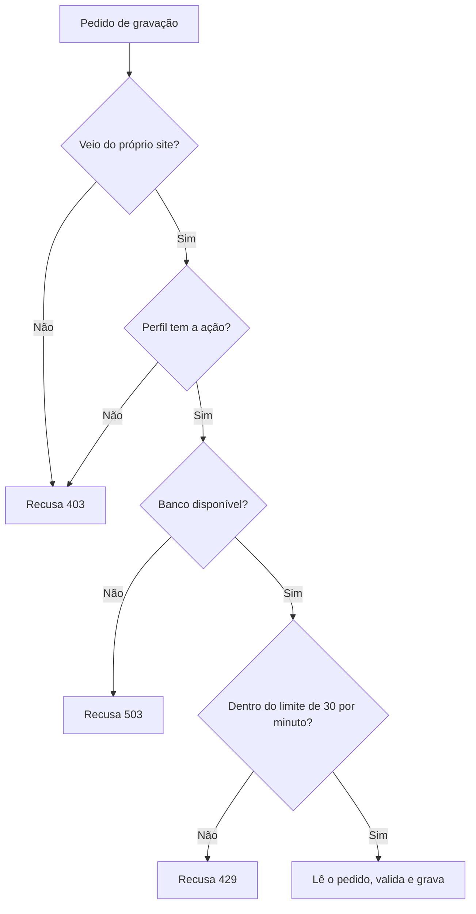

# 4. Perfis de acesso

**Para que serve este capítulo.** Mostra quem pode ver e quem pode gravar cada parte do GovNexa. Traz a matriz de perfis e ações, a matriz de telas por perfil, as permissões especiais e como o sistema recusa um pedido sem permissão, mesmo quando alguém tenta contornar a tela.

## 4.1 Os quatro perfis

Toda pessoa com acesso tem **um** perfil. O banco só aceita estes quatro (`db/d1/central/0001_central.sql`, coluna `usuario.perfil`). O nome mostrado na tela vem de `src/lib/usuarios/lista.ts` (`ROTULO_PERFIL`).

- **Administrador** (`admin`): faz tudo, inclusive cadastrar pessoas, cadastrar secretarias compradoras e dispensar a 2ª etapa do login de outra pessoa.
- **Gestor** (`gestor`): edita projetos, cronogramas, licitações, fotos e documentos, e **aprova ou reprova** a mudança de etapa nas Pendências.
- **Editor** (`editor`): edita como o gestor, mas não aprova etapa nas Pendências.
- **Leitura** (`leitura`): só consulta. É também a **conta de consulta** (seção 4.4).

Regra geral (`src/lib/usuarios/index.ts`, função `usuarioPode`): a pessoa precisa estar **ativa** e o perfil precisa ter a ação. Perfil desconhecido não tem nenhuma ação.

## 4.2 Matriz perfil × ação

As "ações" são as permissões que o código confere. A lista está em `src/lib/usuarios/tipos.ts` (`Acao`) e a distribuição em `src/lib/usuarios/index.ts` (`permissoes`).

| Ação | Admin | Gestor | Editor | Leitura |
|---|:-:|:-:|:-:|:-:|
| `ver` | Sim | Sim | Sim | Sim |
| `editar_projeto` | Sim | Sim | Sim | Não |
| `aprovar_etapa` | Sim | Sim | Não | Não |
| `enviar_documento` | Sim | Sim | Sim | Não |
| `gerenciar_usuarios` | Sim | Não | Não | Não |
| `gerenciar_secretarias_compradoras` | Sim | Não | Não | Não |
| `dispensar_2fa` | Sim | Não | Não | Não |
| `importar` | Sim | Não | Não | Não |

O que cada ação libera, em palavras simples:

- `ver`: consultar telas. O código só confere esta ação em quatro lugares: baixar documento, abrir foto, painel Responsáveis e o CSV dele (`src/lib/documentos/servico.ts`, `src/lib/fotos/servico.ts`, `src/pages/plataforma/gestao-responsaveis/index.astro`, `src/pages/plataforma/gestao-responsaveis/csv.ts`).
- `editar_projeto`: cadastrar e alterar projeto, mover cartão no Kanban, criar e editar cronograma, cadastrar e alterar licitação, ligar e atualizar o PNCP, gravar a localização, buscar endereço, enviar e remover fotos. Também abre o Painel da equipe e as Inconsistências (`src/lib/gestao/equipe.ts`).
- `aprovar_etapa`: aprovar ou reprovar etapa na tela Pendências de etapa (`src/lib/carteira/mover.ts`).
- `enviar_documento`: enviar, classificar (escolher o tipo) e remover documentos do projeto (`src/lib/documentos/servico.ts`).
- `gerenciar_usuarios`: abrir a tela Usuários e usar todas as ações dela (`src/pages/plataforma/usuarios/index.astro`, `src/pages/plataforma/usuarios/acao.ts`).
- `gerenciar_secretarias_compradoras`: cadastrar, editar e desativar secretarias compradoras do PNCP (`src/lib/pncp/servico.ts`, `podeCadastrarSecretaria`).
- `dispensar_2fa`: conceder e retirar a dispensa da 2ª etapa do login (`src/lib/login/servico.ts`, `administradorDispensa`).
- `importar`: **não é usada hoje.** Nenhuma tela ou rota exige esta ação; a carga de planilhas é um comando da equipe técnica (`scripts/importar-planilhas.ts`). **[INCOMPLETO]**

## 4.3 Matriz funcionalidade × perfil, por área do menu

Legenda: **G** = vê e grava; **V** = só vê; **Aviso** = abre a tela, mas vê "sem permissão" (resposta 403) e o item some do menu; **Sim/Não** em telas de simulação. Quando uma tela é demonstrativa, nada é gravado para ninguém.

O menu esconde só três itens por perfil: Usuários, Painel da equipe e Inconsistências (`src/lib/govnexa/catalogo.ts`, `PERMISSAO_DO_ITEM`). Todos os outros aparecem para os quatro perfis.

### Visão gerencial

| Tela | Admin | Gestor | Editor | Leitura |
|---|:-:|:-:|:-:|:-:|
| Projetos prioritários | V | V | V | V |
| Carteira de projetos | V | V | V | V |
| Mapa e painel | V | V | V | V |
| Gestão das licitações | G | G | G | V |
| Kanban por macroetapa | G | G | G | V |
| Gantt geral | V | V | V | V |

- Gestão das licitações e a ficha da licitação: gravar exige `editar_projeto` (`src/lib/contratacoes/servico.ts`, `podeGravarContratacao`). O CSV da lista sai para todos (`src/pages/plataforma/gestao-licitacoes/csv.ts`).
- Secretarias compradoras (dentro da Gestão das licitações): **atualizar os dados do PNCP** exige `editar_projeto`; **cadastrar, editar ou desativar** a secretaria exige `gerenciar_secretarias_compradoras`, só do Administrador (`src/pages/plataforma/gestao-licitacoes/secretarias/index.astro`).
- Kanban: quem não tem `editar_projeto` vê o aviso "Seu perfil permite só consultar o Kanban" (`src/components/carteira/Kanban.astro`).
- O botão "Novo projeto" aparece para todos na Carteira, mas o botão de salvar só aparece com `editar_projeto` (`src/components/carteira/NovoProjeto.astro`), e o servidor recusa o cadastro (`src/lib/carteira/cadastro.ts`).

### Governança da execução

| Tela | Admin | Gestor | Editor | Leitura |
|---|:-:|:-:|:-:|:-:|
| Painel da equipe | V | V | V | Aviso |
| Projetos · Início | V | V | V | V |
| Cronogramas | G | G | G | V |
| Responsáveis e CSV | V | V | V | V |
| Onde está parado | V | V | V | V |
| Inconsistências e CSV | V | V | V | Aviso |
| Pendências de etapa | G | G | V | V |
| Reunião semanal | Sim | Sim | Sim | Sim |
| Sala de guerra | Sim | Sim | Sim | Sim |
| Histórico de alterações | V | V | V | V |
| Alertas | V | V | V | V |
| Processos no SEI | Sim | Sim | Sim | Sim |

- Cronogramas: criar e editar exige `editar_projeto` (`src/lib/cronograma/edicao.ts`, `src/pages/plataforma/cronograma/novo.astro`, `src/pages/plataforma/cronograma/[id].astro`).
- Pendências de etapa: aprovar ou reprovar exige `editar_projeto` **e** `aprovar_etapa` (`src/lib/carteira/mover.ts`, `podeMover`). Editor e Leitura veem o aviso "Aprovar e reprovar etapas é do perfil de gestão" (`src/components/carteira/PendenciasEtapa.astro`).
- Reunião semanal, Sala de guerra e Processos no SEI são **[DEMONSTRATIVO]**: guardam dados só no navegador. "Sim" quer dizer que o perfil abre a tela e mexe na simulação; nada vai para o servidor.
- Atenção: um Editor pode mudar a etapa pelo **Kanban**, embora não possa aprovar nas Pendências (ver seção 4.9).

### Convênios

| Tela | Admin | Gestor | Editor | Leitura |
|---|:-:|:-:|:-:|:-:|
| Visão Convênios | V | V | V | V |
| Captação e acompanhamento | V | V | V | V |
| Alertas da Captação e agenda | V | V | V | V |
| Oportunidades | V | V | V | V |
| Projetos da Captação | V | V | V | V |
| Comparativo | V | V | V | V |
| Qualidade dos dados | V | V | V | V |

- Todas as telas de Convênios são só de leitura, para todos (`src/pages/plataforma/convenios/index.astro`, comentário do topo). Os dados vêm das coletas automáticas de dados públicos, não do banco da prefeitura.
- Projetos da Captação usa só exemplos fictícios. **[DEMONSTRATIVO]** (`src/lib/projetos/guia.ts`)
- Algumas guias mostram o botão "Novo registro", que só responde "protótipo: nada é gravado" (`src/pages/plataforma/[...module].astro`).

### Licitações (demonstrativo)

Operação, Planejamento, Preços, Automação, Mercado, Cadastros e Prazos da Lei 14.133 aparecem para os quatro perfis. São **[DEMONSTRATIVO]**: os botões avisam "protótipo" e nada é gravado (`src/lib/govnexa/catalogo.ts`, `GRUPO_PARA_MODULO`; `src/pages/plataforma/[...module].astro`). A gestão real das licitações fica na Visão gerencial.

### Conta

| Tela | Admin | Gestor | Editor | Leitura |
|---|:-:|:-:|:-:|:-:|
| Usuários | G | Aviso | Aviso | Aviso |
| Fluxo do sistema | V | V | V | V |
| WhatsApp | Sim | Sim | Sim | Sim |
| Relatórios, Perfil, Configurações | V | V | V | V |

- Usuários: sem `gerenciar_usuarios` a tela responde 403 e o item some do menu (`src/pages/plataforma/usuarios/index.astro`).
- WhatsApp é **[DEMONSTRATIVO]**: nada é enviado e os números somem ao fechar a aba (`src/lib/whatsapp/simulacao.ts`).
- Perfil e Configurações são demonstrativos e ficam com os campos travados (`src/pages/plataforma/[...module].astro`, variável `account`).

### Telas abertas a partir de outras (fora do menu)

| Tela | Admin | Gestor | Editor | Leitura |
|---|:-:|:-:|:-:|:-:|
| Ficha do projeto | G | G | G | V |
| Localização do projeto | G | G | G | V |
| Fotos do projeto | G | G | G | V |
| Documentos do projeto | G | G | G | V |
| Página do cronograma | G | G | G | V |
| Obras sem localização | V | V | V | V |
| Fluxo detalhado de uma etapa | V | V | V | V |

- Ficha: os botões de edição só aparecem com `editar_projeto` (`src/pages/plataforma/projeto/[id].astro`); gravar passa por `src/lib/carteira/edicao.ts` e pela localização em `src/lib/mapa/servico.ts`.
- Fotos: enviar e remover exigem `editar_projeto`; quem não pode lê "Seu perfil permite apenas ver as fotos" (`src/lib/fotos/servico.ts`).
- Documentos: enviar, classificar e remover exigem `enviar_documento`; baixar exige `ver` (`src/lib/documentos/servico.ts`).

## 4.4 A conta de consulta

A **conta de consulta** é uma pessoa com o perfil **Leitura**, cadastrada pelo Administrador na tela Usuários. Ela recebe o convite por e-mail e cria a própria senha. Não existe outro tipo de conta de consulta no código (`README.md`, decisão de 23/11/2026; `src/lib/usuarios/index.ts`).

- Ela só tem a ação `ver`. Pode abrir quase tudo, mas não grava nada.
- Se for preciso, o Administrador pode **dispensar a 2ª etapa do login** dela por um prazo (seção 4.5). Assim, ela entra só com e-mail e senha.
- A conta **não expira sozinha**. O banco não tem data de fim para a pessoa; para encerrar o acesso, o Administrador desativa a pessoa. Só a dispensa da 2ª etapa tem prazo (`db/d1/central/0001_central.sql`, `db/d1/central/0003_excecao_2fa.sql`).

## 4.5 Permissões especiais

### Secretarias compradoras do PNCP

As secretarias compradoras são os órgãos da prefeitura que fazem compras no Portal Nacional de Contratações Públicas (PNCP). O cadastro delas tem uma permissão própria, `gerenciar_secretarias_compradoras`, que hoje só o Administrador tem (`src/pages/plataforma/gestao-licitacoes/secretarias/gravar.ts`, `src/lib/pncp/http.ts`, `atenderOrgao`).

- Cadastrar, editar e desativar a secretaria: só Administrador.
- Atualizar os dados vindos do PNCP e ligar uma licitação ao PNCP: Administrador, Gestor e Editor (`src/lib/pncp/servico.ts`, `podeUsarPncp`).

### Dispensar a 2ª etapa do login

A 2ª etapa é o código de 6 dígitos do aplicativo autenticador. A permissão `dispensar_2fa` deixa o Administrador liberar outra pessoa a entrar só com e-mail e senha por um tempo (`src/lib/login/servico.ts`, `dispensarSegundaEtapa`).

- Só para **outra pessoa**, nunca para si: "Você não pode dispensar a sua própria verificação."
- Prazo de 1 a 60 dias e motivo de 3 a 200 caracteres. O banco também garante o prazo e que quem concede é diferente de quem recebe (`db/d1/central/0003_excecao_2fa.sql`).
- Um Administrador que está com a própria 2ª etapa dispensada **não pode** conceder dispensa, criar outro Administrador nem redefinir a 2ª etapa de outra pessoa.
- A pessoa precisa estar ativa e ser da mesma prefeitura. Pode ter qualquer perfil.
- Retirar a dispensa, mudar o perfil ou desativar a pessoa encerra a dispensa e as sessões abertas por ela.
- Tudo fica no registro de eventos de acesso (`evento_acesso`).

## 4.6 Como o servidor recusa um pedido sem permissão

Esconder um botão não basta: qualquer pessoa pode montar um pedido à mão. Por isso o GovNexa confere a permissão **duas vezes**:

1. **Na tela**: o menu esconde o item e a tela esconde o botão de gravar, ou mostra um aviso.
2. **No servidor**: toda rota de gravação confere o perfil de novo, antes de ler o conteúdo do pedido. Sem a ação, a resposta é **403** (proibido) com uma mensagem simples, por exemplo "Seu perfil não permite alterar projetos." (`src/lib/carteira/edicao.ts`).

Antes disso, toda página de `/plataforma/` passa pelo controle de entrada (`worker/index.ts`, função `atender`):

- Sem sessão válida, a pessoa vai para a tela de login (resposta 302), que guarda a tela pedida para voltar depois.
- No modo alternativo de login pelo Cloudflare Access, crachá inválido dá 403 "Acesso negado" e e-mail sem cadastro ativo dá 403 "Sem permissão".
- Se o banco da prefeitura não puder ser aberto, a resposta é 503 "Serviço indisponível".
- Endereços começados por `/api` respondem 404: não há interface aberta para programas externos.

Nas rotas de gravação, a ordem das conferências é sempre a mesma (`src/pages/plataforma/projeto/criar.ts`, `src/pages/plataforma/documentos-projeto/enviar.ts`):

O limite de 30 gravações por minuto é contado por prefeitura e e-mail; se o contador falhar, o pedido é recusado (`src/lib/seguranca/limite.ts`, `wrangler.jsonc`, `ratelimits`). Nas telas de documentos e fotos, a recusa volta como mensagem na própria tela, em vez da página de erro.

## 4.7 Isolamento por prefeitura

Cada pessoa pertence a uma prefeitura, e cada prefeitura tem o **seu próprio banco de dados**. O isolamento funciona assim (`src/lib/usuarios/index.ts`, `prefeituraDoUsuario`; `src/lib/repositorio/index.ts`, `repositorioDoUsuario`):

- A prefeitura vem **só do cadastro central** da pessoa. Nenhuma tela deixa escolher outra prefeitura.
- O sistema confere que a prefeitura está ativa, que o número dela é o código IBGE e que o nome do banco é exatamente `DB_PREFEITURA_<código IBGE>`. Qualquer diferença impede o acesso.
- Quase toda tabela do banco da prefeitura tem o número da prefeitura na chave (capítulo 5).
- Na tela Usuários, a pessoa de outra prefeitura é tratada como se não existisse (`src/lib/login/servico.ts`, `alvo`).
- Documentos e fotos ficam no armazenamento de arquivos com a chave guardada no banco da prefeitura; a foto confere ainda que a chave começa pela prefeitura e pelo projeto (`src/lib/fotos/servico.ts`).

Exceção a conhecer: as telas de **Convênios** e os alertas de convênio usam o município marcado como piloto em `data/config/municipio.json` (`src/lib/municipio-ativo.ts`), e não a prefeitura da pessoa. Hoje há uma só prefeitura, então não há efeito. Com uma segunda prefeitura, todas veriam os convênios do município piloto. São dados públicos, mas a regra precisa mudar antes (capítulo 7).

## 4.8 Telas que só exigem login

Estas telas não conferem nenhuma ação: basta estar logado e ativo. Conferido no código, uma a uma:

| Tela | Arquivo | Confere ação? |
|---|---|---|
| Alertas | `src/components/alertas/CentralAlertas.astro` | Não |
| WhatsApp | `src/components/whatsapp/WhatsAppGestao.astro` | Não |
| Histórico de alterações | `src/components/log/LogAlteracoes.astro` | Não |
| Reunião semanal | `src/components/reuniao/ReuniaoSemanal.astro` | Não |
| Sala de guerra | `src/pages/plataforma/sala-de-guerra/[id].astro` | Não |
| Fluxo e fluxo detalhado | `src/pages/plataforma/fluxo/[id].astro` | Não |
| Página do cronograma | `src/pages/plataforma/cronograma/[id].astro` | Só para editar |
| Gestão das licitações | `src/pages/plataforma/gestao-licitacoes/index.astro` | Só para editar |
| CSV das licitações | `src/pages/plataforma/gestao-licitacoes/csv.ts` | Não |
| Obras sem localização | `src/pages/plataforma/projetos-localizacao/index.astro` | Não |
| Documentos, escolha do projeto | `src/pages/plataforma/documentos-projeto/index.astro` | Não |
| Documentos do projeto, lista | `src/pages/plataforma/documentos-projeto/projeto/[id].astro` | Só para enviar |

Também só exigem login: a tela inicial, a Visão Convênios, a agenda `.ics` (`src/pages/plataforma/agenda.ics.ts`) e todas as telas montadas pela página geral `src/pages/plataforma/[...module].astro` (Carteira, Kanban, Gantt, Cronogramas, Onde está parado, Pendências, Captação e demonstrativos).

**Efeito prático hoje: nenhum.** Os quatro perfis têm a ação `ver`, então quem está logado poderia abrir essas telas de qualquer jeito. O risco é futuro: se um dia existir um perfil **sem** `ver`, ele ainda abriria todas essas telas. Ver capítulo 7.

## 4.9 Pontos de atenção

- **Aprovar etapa pelo Kanban.** O servidor só exige `aprovar_etapa` quando o pedido diz que veio das Pendências. Essa origem é informada pelo próprio pedido. Pelo Kanban, o Editor move o projeto de etapa com as mesmas regras de portão e motivo, sem precisar de `aprovar_etapa` (`src/lib/carteira/mover.ts`, `podeMover`). Na prática, a aprovação nas Pendências não impede o Editor de mudar a etapa. [VERIFICAR] com o dono se é a regra desejada.
- **Tudo visível para Leitura.** Valores, nomes de responsáveis e o Histórico aparecem para todos os perfis. [VERIFICAR] se o perfil Leitura deve ver tudo.
- **Ação `importar` sem uso** (seção 4.2).
- **Login pelo Cloudflare Access** continua no código como modo alternativo, embora o login por senha esteja ligado em produção (`wrangler.jsonc`, `LOGIN_MODO`; `worker/index.ts`).

## Onde aprofundar

- Login, convite, 2ª etapa e limites contra abuso: capítulo de Usuários, login e segurança.
- Tabelas de usuários, sessões e dispensas: capítulo 5, seção do banco central.
- Pendências ligadas a permissões: capítulo 7, categoria Segurança e permissões.
