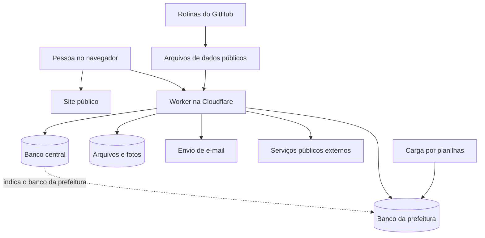
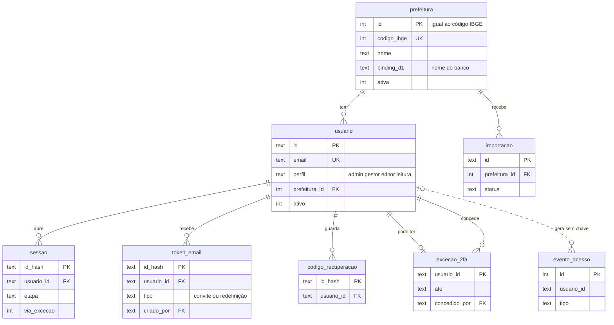
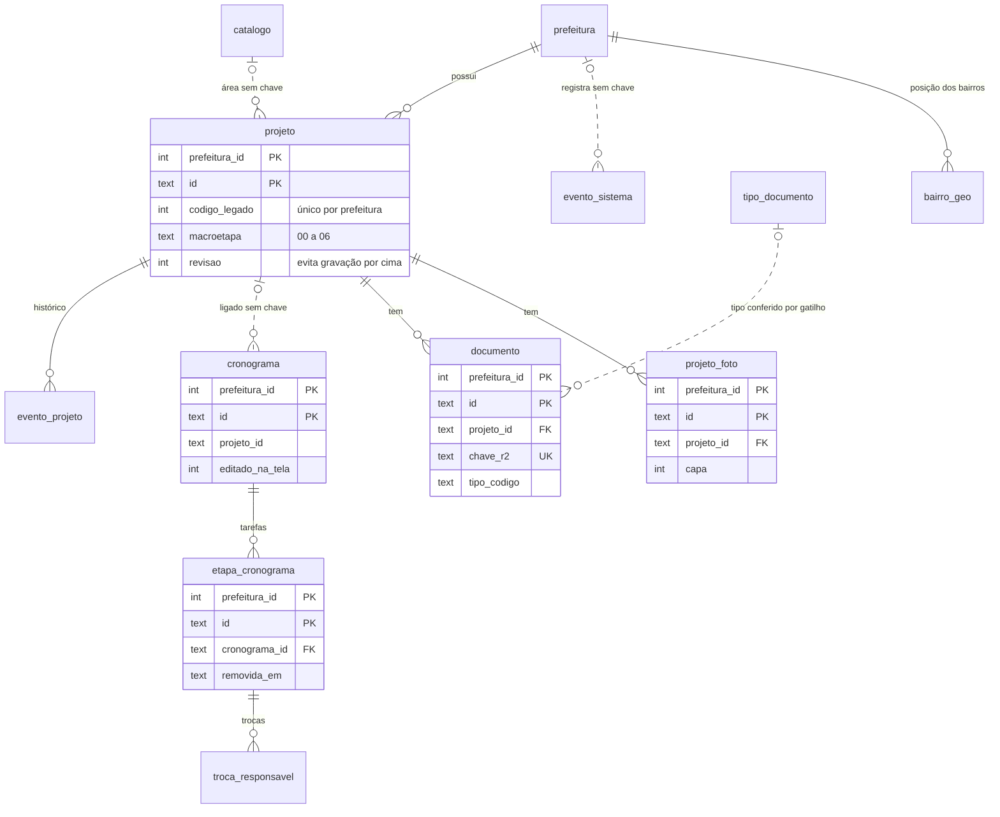
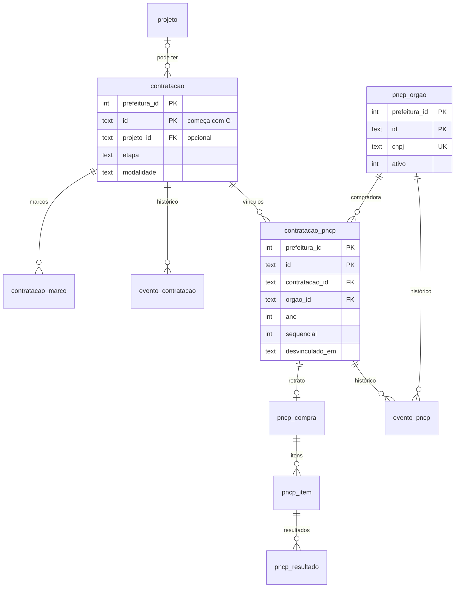

# 5. Correlações e dependências

**Para que serve este capítulo.** Mostra como as partes do GovNexa se ligam: qual módulo alimenta qual, onde os dados ficam guardados, como as tabelas se relacionam e de quais serviços de fora o sistema depende. Ajuda a entender o que é afetado quando uma parte muda ou fica fora do ar.

## 5.1 Matriz de dependência entre módulos

Leia cada **linha** assim: "este módulo **usa** os dados da coluna marcada com X". As colunas são os módulos que mais fornecem dados aos outros.

Siglas das colunas: **Ace** = Usuários e acesso; **Car** = Carteira de projetos; **Cro** = Cronogramas; **Lic** = Licitações e PNCP; **Cnv** = Convênios e coletas de dados públicos; **Arq** = Arquivos, documentos e fotos; **His** = Histórico de alterações.

| Módulo que usa | Ace | Car | Cro | Lic | Cnv | Arq | His |
|---|:-:|:-:|:-:|:-:|:-:|:-:|:-:|
| Carteira, Kanban e Gantt | X |  |  |  |  |  | X |
| Ficha do projeto | X | X | X | X |  | X | X |
| Mapa e localização | X | X |  |  |  |  |  |
| Fotos e documentos | X | X |  |  |  | X | X |
| Cronogramas e Responsáveis | X | X |  |  |  |  | X |
| Licitações e PNCP | X | X |  |  |  |  |  |
| Projetos prioritários | X | X |  |  |  |  |  |
| Mapa e painel | X | X | X |  |  |  |  |
| Painel da equipe | X | X | X |  | X |  |  |
| Alertas | X | X | X |  | X |  |  |
| Histórico | X | X |  |  |  |  |  |
| Reunião e Sala de guerra | X | X | X |  |  |  | X |
| WhatsApp | X | X |  |  | X |  |  |
| Convênios e Captação | X |  |  |  | X |  |  |
| Fluxo do sistema | X |  |  |  |  |  |  |

O que cada ligação quer dizer:

- **Usuários e acesso alimenta todos.** Toda tela de `/plataforma/` recebe a pessoa logada e o banco da prefeitura dela antes de abrir (`worker/index.ts`, `src/middleware.ts`). As permissões estão no capítulo 4.
- **Carteira é a base.** O projeto é a peça central: cronograma, licitação, documento, foto, localização e histórico se prendem ao código do projeto (`db/d1/prefeitura/0001_carteira.sql`, `db/d1/prefeitura/0010_contratacao.sql`).
- **Carteira, cronogramas, fotos e documentos gravam no Histórico.** Cadastro, edição, mudança de etapa, edição de cronograma, envio e remoção de foto e troca de tipo de documento viram uma linha no Histórico (`src/lib/repositorio/d1.ts`, `src/lib/fotos/repositorio.ts`, `src/lib/documentos/repositorio.ts`). Enviar e remover documento **não** gravam no Histórico (capítulo 7).
- **Licitações e PNCP usam a Carteira**: a licitação pode estar ligada a um projeto, e a ficha do projeto mostra as licitações dele (`src/pages/plataforma/projeto/[id].astro`). Licitações têm histórico próprio (`evento_contratacao`, `evento_pncp`), que não aparece na tela de Histórico (`db/d1/prefeitura/0001_carteira.sql`, visão `log_alteracoes`).
- **Mapa e localização usam a Carteira** (bairro e posição de cada projeto) e a tabela de posição dos bairros (`src/lib/mapa/obras.ts`, `db/d1/prefeitura/0005_bairro_geo.sql`).
- **Painel da equipe e Alertas juntam três fontes**: a carteira, os cronogramas e os dados de convênios coletados (`src/components/dashboard/DashboardPrefeito.astro`, `src/components/alertas/CentralAlertas.astro`).
- **Reunião e Sala de guerra** leem a carteira, os cronogramas e o histórico; as salas vêm só de dados de exemplo. **[DEMONSTRATIVO]** (`src/components/reuniao/ReuniaoSemanal.astro`, `src/lib/sala/carga.ts`)
- **WhatsApp** monta os relatórios simulados com a carteira e o resumo da Captação. **[DEMONSTRATIVO]** (`src/components/whatsapp/WhatsAppGestao.astro`)
- **Convênios e Captação** dependem só das coletas de dados públicos, guardadas como arquivos no próprio sistema, e não do banco da prefeitura (`src/lib/dados/index.ts`, `src/lib/dados/arquivos.ts`).
- **Fluxo do sistema** não lê dados: o desenho é escrito no código e aponta para as telas reais (`src/lib/govnexa/fluxo.ts`, `src/lib/govnexa/subfluxos.ts`).
- **Carga por planilhas** alimenta a Carteira e os Cronogramas uma vez, de fora do sistema; depois, o que foi editado na tela vence a planilha (`scripts/importar-planilhas.ts`).

## 5.2 Arquitetura em uma página

Em palavras simples:

- **Site público** (início, Sobre, Insights e outras): páginas prontas, abertas a todos, sem dados internos.
- **Plataforma** (`/plataforma/`): só para pessoas cadastradas. Todo pedido passa primeiro por um **Worker**, um programa que roda nos servidores da Cloudflare. Ele confere o login, descobre a prefeitura da pessoa e entrega só os dados dela.
- **Banco central**: quem pode entrar, perfis, sessões e qual banco cada prefeitura usa (`wrangler.jsonc`, `DB_CENTRAL`).
- **Banco da prefeitura**: um banco por prefeitura, com projetos, cronogramas, licitações, PNCP e históricos (`wrangler.jsonc`, `DB_PREFEITURA_5208707`).
- **Armazenamento de arquivos**: documentos e fotos. O banco guarda só a chave de cada arquivo (`wrangler.jsonc`, `DOCUMENTOS`).
- **Coleta de dados públicos**: rotinas agendadas no GitHub baixam os dados, gravam arquivos de dados e abrem um pedido de atualização para o dono aprovar (`.github/workflows/atualizar-dados.yml`, `.github/workflows/atualizar-dados-mensais.yml`).
- **Cache de 30 segundos**: os dados da prefeitura ficam guardados por até 30 segundos em cada servidor, para a tela abrir mais rápido (`src/lib/repositorio/cache.ts`).

## 5.3 Banco central

O banco central guarda quem pode entrar e de qual prefeitura é. Foi conferido nas migrações `db/d1/central/0001_central.sql`, `db/d1/central/0002_login.sql` e `db/d1/central/0003_excecao_2fa.sql`.

A tabela `limite_tentativa` (contadores de tentativas por endereço, e-mail e conta) fica solta, sem ligação, e por isso não aparece no desenho (`db/d1/central/0002_login.sql`).

O que cada entidade guarda:

- **Prefeitura**: cada prefeitura cliente. O número dela é o código IBGE, e `binding_d1` diz qual banco ela usa. Hoje há uma só.
- **Usuário**: a pessoa com acesso. Guarda e-mail, nome, cargo, perfil, prefeitura, se está ativa, a senha protegida e os dados da 2ª etapa. O e-mail não se repete.
- **Sessão**: cada entrada aberta no sistema, com validade. Marca se a entrada foi feita com dispensa da 2ª etapa. O código da sessão é guardado só em forma embaralhada (resumo).
- **Token de e-mail**: o link de convite (vale 24 horas) ou de troca de senha (vale 1 hora). Só pode ser usado uma vez.
- **Código de recuperação**: os 10 códigos de reserva da 2ª etapa, de uso único.
- **Dispensa da 2ª etapa** (`excecao_2fa`): a liberação temporária para entrar só com senha. Cada pessoa tem no máximo uma. Guarda até quando vale e quem concedeu.
- **Evento de acesso**: o registro de segurança (login recusado, dispensa concedida, perfil alterado e outros). A ligação com a pessoa não tem chave no banco, para o registro ficar mesmo se algo mudar.
- **Importação**: o registro de cada carga de planilha, com contagens e situação.

## 5.4 Banco da prefeitura

Cada prefeitura tem o seu banco. Quase toda tabela usa a dupla **prefeitura + código** como chave, o que reforça o isolamento. Histórico só se acrescenta: não pode ser alterado nem apagado. Remover um documento ou uma foto só marca a data; a linha continua guardada. Conferido nas migrações `db/d1/prefeitura/0001_carteira.sql` a `db/d1/prefeitura/0011_pncp.sql`.

O desenho foi dividido em duas partes para caber na página.

### Projetos, cronogramas, arquivos e histórico

Notas do desenho:

- Linhas tracejadas são ligações **sem chave no banco**: o código ou um gatilho confere. É o caso de cronograma para projeto, documento para tipo de documento, projeto para área do catálogo e o histórico do sistema (`db/d1/prefeitura/0001_carteira.sql`, `db/d1/prefeitura/0003_tipo_documento.sql`, `db/d1/prefeitura/0007_area_prioritario_catalogo.sql`).
- A tela de Histórico lê a **visão** `log_alteracoes`, uma consulta pronta que junta `evento_projeto` e `evento_sistema`. Não é uma tabela (`db/d1/prefeitura/0001_carteira.sql`).
- A tabela `prefeitura` deste banco é uma cópia mínima: só número, nome e UF.
- `troca_responsavel` também aponta para o cronograma, além da tarefa (`db/d1/prefeitura/0009_cronograma_na_tela.sql`).

O que cada entidade guarda:

- **Projeto**: o cadastro da obra ou ação. Nome, órgão, etapa (00 a 06), valores, datas, número no SEI, localização, compromisso, área e se é prioritário. O campo `revisao` muda a cada gravação: se duas pessoas editarem ao mesmo tempo, a segunda é avisada em vez de apagar o trabalho da primeira.
- **Evento do projeto**: cada mudança no projeto. O que mudou, quem fez, quando, de onde veio, o antes e o depois e o motivo. Não pode ser alterado.
- **Evento do sistema**: mudanças que não são do cadastro do projeto, como cronograma, fotos, tipo de documento e cargas.
- **Cronograma**: o plano de um projeto, vindo da planilha ou criado na tela. Se foi editado na tela, a planilha não o altera mais e ele não pode ser apagado.
- **Tarefa do cronograma** (`etapa_cronograma`): cada tarefa, com fase, responsável, unidade e datas previstas e reais. Remover só marca a data.
- **Troca de responsável**: cada troca do responsável de uma tarefa. Nunca se apaga; corrigir é registrar nova troca.
- **Documento**: o arquivo do projeto (nome, tamanho, impressão digital, tipo, quem enviou e quem removeu). O mesmo arquivo não entra duas vezes no mesmo projeto.
- **Tipo de documento**: a lista de tipos da prefeitura. DFD, ETP e TR são fixos; outros (Mapa de riscos, ART e outros) nascem desligados. Nada se apaga, só se desliga.
- **Foto do projeto**: as fotos da obra, com legenda, data e capa. Cada projeto tem no máximo uma capa.
- **Catálogo**: as listas da prefeitura, como áreas, órgãos e regiões. Um item não se apaga, só se desliga.
- **Posição dos bairros** (`bairro_geo`): a posição aproximada de cada bairro, usada no mapa quando a obra não tem ponto exato.

### Licitações e PNCP

Notas do desenho:

- Uma licitação tem no máximo **um** vínculo ativo com o PNCP, e uma compra do PNCP só pode estar ligada a uma licitação ativa por vez (`db/d1/prefeitura/0011_pncp.sql`, índices únicos `contratacao_pncp_ativo_*`).
- O vínculo confere a secretaria compradora duas vezes: pelo código e pelo CNPJ.
- `evento_pncp` também pode apontar direto para a licitação (`db/d1/prefeitura/0011_pncp.sql`).

O que cada entidade guarda:

- **Contratação**: cada licitação ou contratação da prefeitura. Etapa (de finalização a concluída), modalidade, valores em centavos, datas e onde está. Pode estar ligada a um projeto, ou não.
- **Marco da contratação**: as datas importantes, como homologação, contrato, ordem de serviço e início da execução, e se já foram cumpridas.
- **Evento da contratação**: o histórico da licitação. Não pode ser alterado.
- **Secretaria compradora** (`pncp_orgao`): o órgão da prefeitura que compra no PNCP, pelo CNPJ.
- **Vínculo com o PNCP** (`contratacao_pncp`): liga a licitação à compra publicada no PNCP (ano e número sequencial). Desligar só marca a data.
- **Retrato da compra, itens e resultados**: a última leitura feita no PNCP: situação da compra, cada item e quem venceu. É regravado a cada atualização.
- **Evento do PNCP**: o histórico do cadastro de secretarias, dos vínculos e das leituras.

## 5.5 Dependências externas

O GovNexa usa serviços de fora. Se um deles parar, só a parte que depende dele é afetada.

| Serviço | Para que serve | Como chega |
|---|---|---|
| Transferegov | Convênios e repasses | Coleta diária |
| CAUC | Regularidade do município | Coleta diária |
| SICONFI | Dados fiscais do Tesouro | Coleta diária |
| FNS | Repasses da saúde | Coleta diária |
| IBGE | Lista de municípios e população | Coleta diária |
| INEP | Dados da educação | Coleta mensal |
| CNES | Estabelecimentos de saúde | Coleta mensal |
| SINISA | Dados de saneamento | Coleta mensal |
| DOU | Diário Oficial da União | Coletor manual |
| PNCP | Compras públicas | Botão na tela |
| OpenStreetMap | Mapa e busca de endereço | Na hora |
| SEI | Processos administrativos | Só simulação |
| E-mail | Convite e troca de senha | Na hora |
| Cloudflare | Servidor, bancos, arquivos, login | Sempre |
| GitHub | Código, testes e coletas | Rotinas |

Detalhes e origem de cada um:

- **Coletas diárias** (Transferegov, CAUC, SICONFI, FNS, IBGE e programas abertos): rodam todo dia às 12h30 UTC, que são 9h30 em Brasília (`.github/workflows/atualizar-dados.yml`). Cada coletor tenta 3 vezes e registra o resultado (`coletores/rodar.ts`). Os dados entram no site só depois que o dono aprova o pedido de atualização no GitHub.
- **Coletas mensais** (INEP, SINISA e CNES): rodam no dia 5 de cada mês às 11h UTC, que são 8h em Brasília (`.github/workflows/atualizar-dados-mensais.yml`).
- **DOU e Portal da Transparência**: há coletores (`coletores/dou.ts`, `coletores/portal-transparencia.ts`), mas eles não estão na rotina diária. O Portal da Transparência só roda quando alguém dispara à mão, e nenhuma tela lê esses dados. **[INCOMPLETO]**
- **CNPJ dos fundos (Receita Federal)**: coletor de carga manual (`coletores/receita-cnpj-fundos.ts`).
- **PNCP**: o sistema só consulta o Portal Nacional de Contratações Públicas quando alguém aperta o botão de ligar ou atualizar. Endereço fixo, tempo limite e teto de tamanho na resposta (`src/lib/pncp/cliente.ts`). A atualização automática ainda é só prevista (E14b a E14e).
- **OpenStreetMap**: fornece as imagens do mapa e a busca de endereço (Nominatim), com no máximo 1 pedido por segundo em cada servidor (`src/lib/mapa/busca-endereco.ts`). O mapa também pode usar a imagem de satélite da Esri (`worker/index.ts`, política de conteúdo `server.arcgisonline.com`).
- **SEI**: o sistema só aceita e guarda o link do processo; a leitura diária do SEI é simulação. **[DEMONSTRATIVO]** (`src/components/sei/ProcessosSei.astro`, `src/lib/sei/link.ts`)
- **E-mail**: enviado pelo serviço de e-mail da Cloudflare, de um único remetente de não-resposta (`wrangler.jsonc`, `send_email`; `src/lib/login/email.ts`).
- **Cloudflare**: hospeda o Worker, os dois bancos, o armazenamento de arquivos, o limite de pedidos por minuto, a verificação "não sou robô" (Turnstile) no login e, como alternativa, o login Access (`wrangler.jsonc`, `worker/index.ts`).
- **GitHub**: guarda o código, exige pedido de revisão para mudar a versão principal, roda os testes e as coletas de dados.

## Onde aprofundar

- Quem pode ver e gravar cada módulo: capítulo 4.
- Regras de cada módulo, telas e processos: capítulos dos módulos.
- Ligações sem chave no banco, regras duplicadas e coletas fora do pacote de dados: capítulo 7.
